# CHƯƠNG 2: PHÂN TÍCH, THIẾT KẾ VÀ CÀI ĐẶT HỆ THỐNG

*(Bản hoàn chỉnh đã được cập nhật đồng bộ 100% với kiến trúc hiện tại của dự án: Mô hình phân quyền 2 vai trò `SUPER_ADMIN` & `ADMIN` giới hạn theo Khu vực `campus_id`, Backend FastAPI + SQLAlchemy AsyncPG + Pure WebSocket + In-Memory Realtime Store, Chặn ứng dụng mạng xã hội tự động khóa màn hình và Truyền phát màn hình trực tiếp Live Stream).*

---

## 2.1. Phân tích yêu cầu

### 2.1.1. Bối cảnh vận hành và ràng buộc

Hệ thống nhắm tới các thiết bị Android (máy tính bảng, điện thoại thông minh) do nhà trường sở hữu hoặc đơn vị đầu tư cấp phát phục vụ học tập, không nhắm tới mô hình thiết bị cá nhân tự mang đến (BYOD). Ràng buộc này xuất phát từ cơ chế bảo mật của hệ điều hành Android: ứng dụng `Android Agent` chỉ có thể thực thi cưỡng chế các tác vụ cấp hệ thống như khóa màn hình tức thời (`lockNow`), chế độ khóa Kiosk (`startLockTask`), khôi phục cài đặt gốc (`wipeData`), ẩn ứng dụng (`setApplicationHidden`) hoặc cài đặt bản cập nhật ngầm (`PackageInstaller`) khi được cấp đặc quyền **Device Owner**.

Đặc quyền này được kích hoạt thông qua lệnh:
```bash
adb shell dpm set-device-owner com.edusphere.agent/.receiver.MDMAdminReceiver
```
trên thiết bị vừa khôi phục cài đặt gốc hoặc chưa đăng nhập tài khoản cá nhân khác. Hệ quả là quy trình triển khai ban đầu gồm một bước cấp quyền qua cáp USB cho từng thiết bị trước khi bàn giao về các cơ sở trường học; đổi lại, sau khi cấp quyền một lần, toàn bộ quá trình ghi danh vào lớp học và vận hành về sau đều diễn ra hoàn toàn tự động qua mã QR và mạng không dây.

Về mô hình tổ chức vận hành, hệ thống được tinh gọn theo **mô hình 2 vai trò quản trị (2-Role Model)**:
1. **Super Admin (`SUPER_ADMIN`)**: Quản trị viên cấp cao quản lý toàn bộ hệ thống đa cơ sở (Multi-Campus), khởi tạo Khu vực (`Campus`) và cấp phát tài khoản cho Quản trị viên từng khu vực.
2. **Admin Khu vực (`IT_ADMIN` / `ADMIN`)**: Tài khoản quản trị vận hành tại một Khu vực (`campus_id`) cụ thể, được sử dụng chung bởi cán bộ CNTT và giáo viên của cơ sở đó để quản lý Trường học, Lớp học, Thiết bị, Mã QR ghi danh, Giám sát màn hình trực tiếp, Bản đồ 3D và Xử lý cảnh báo vi phạm trong đúng khu vực được phân công.

Mạng vận hành tiêu chuẩn là mạng nội bộ (LAN/Wi-Fi) của trường học hoặc máy chủ đám mây. Giao diện `Web Dashboard` tự động suy ra địa chỉ máy chủ API và WebSocket từ tên miền đang truy cập (`http://${window.location.hostname}:8081/api` trong `web-dashboard/src/config/axios.ts`). Phía `Android Agent` cho phép cấu hình linh hoạt địa chỉ IP/Domain của máy chủ ngay tại màn hình ghi danh và hỗ trợ kết nối nội bộ thông qua cấu hình `cleartextTrafficPermitted="true"` trong `network_security_config.xml`.

---

### 2.1.2. Yêu cầu chức năng

Bảng 2.1 liệt kê danh sách các yêu cầu chức năng của hệ thống sau khi chuẩn hóa mô hình 2 vai trò, vai trò được phép truy cập và vị trí cài đặt thực tế trong mã nguồn. Cột **"Mức"** phản ánh trạng thái hoàn thiện: **Đủ** (đã hoàn thiện đồng bộ cả Backend, Frontend và Agent).

**Bảng 2.1. Yêu cầu chức năng của hệ thống**

| Mã | Yêu cầu chức năng | Vai trò được phép | Vị trí cài đặt chính | Mức |
| :--- | :--- | :--- | :--- | :--- |
| **FR01** | Đăng nhập, làm mới token (Refresh Token), đăng xuất | Tất cả người dùng quản trị | `routers/auth.py`, `services/auth_service.py`, `Login.tsx`, `axios.ts` | Đủ |
| **FR02** | Quản lý tài khoản Admin, phân công Khu vực (`campus_id`), khóa/mở khóa | `SUPER_ADMIN` | `routers/users.py`, `UserListPage.tsx` | Đủ |
| **FR03** | Quản lý danh mục Khu vực / Cơ sở (`Campus`) | `SUPER_ADMIN` (CRUD), `IT_ADMIN` (Xem cơ sở của mình) | `routers/schools.py`, `CampusListPage.tsx` | Đủ |
| **FR04** | Quản lý Trường học (`School`) theo phạm vi Khu vực | `SUPER_ADMIN`, `IT_ADMIN` | `routers/schools.py`, `SchoolListPage.tsx` | Đủ |
| **FR05** | Quản lý Lớp học (`Classroom`) theo phạm vi Khu vực | `SUPER_ADMIN`, `IT_ADMIN` | `routers/schools.py`, `ClassroomListPage.tsx` | Đủ |
| **FR06** | Tạo, xem, thu hồi mã ghi danh; sinh mã QR theo Khu vực/Trường/Lớp | `SUPER_ADMIN`, `IT_ADMIN` | `routers/enrollments.py`, `EnrollmentListPage.tsx` | Đủ |
| **FR07** | Đăng ký (Ghi danh) thiết bị vào hệ thống bằng mã hoặc quét QR | `Android Agent`, Người dùng thiết bị | `routers/devices.py` (`register_device`), `MainActivity.kt` | Đủ |
| **FR08** | Xem danh sách, chi tiết, lọc thiết bị trong phạm vi Khu vực | `SUPER_ADMIN`, `IT_ADMIN` | `routers/devices.py`, `DeviceListPage.tsx`, `DeviceDetailPage.tsx` | Đủ |
| **FR09** | Cập nhật thông tin, gán lớp học, gỡ lớp hoặc xóa thiết bị | `SUPER_ADMIN`, `IT_ADMIN` (trong Khu vực) | `routers/devices.py` (`update`, `assign`, `delete`), `DeviceListPage.tsx` | Đủ |
| **FR10** | Thu thập và hiển thị chỉ số thời gian thực (RAM, CPU, Pin, Bộ nhớ, Wi-Fi, App đang mở) | `Android Agent`, `Web Dashboard` | `DeviceMonitor.kt`, `HeartbeatService.kt`, `ws/agent_ws.py`, `useWebSocket.ts` | Đủ |
| **FR11** | Gửi lệnh điều khiển thiết bị từ xa (Khóa máy, Mở khóa, Còi báo động, Cảnh báo, Xóa dữ liệu, OTA...) | `SUPER_ADMIN`, `IT_ADMIN` (trong Khu vực) | `routers/commands.py`, `services/command_service.py`, `DeviceActionManager.kt` | Đủ |
| **FR12** | Xem màn hình thiết bị trực tiếp theo thời gian thực (Live Screen Streaming) | `SUPER_ADMIN`, `IT_ADMIN` (trong Khu vực) | `ScreenCaptureService.kt`, `ScreenCaptureManager.kt`, `ws/agent_ws.py`, `DeviceDetailPage.tsx` | Đủ |
| **FR13** | Tự động phát hiện ứng dụng mạng xã hội/giải trí bị cấm, khóa màn hình tức thời và gửi cảnh báo | `Android Agent`, `MDM Server` | `RuleDetector.kt`, `LockActivity.kt`, `ws/agent_ws.py` (`_handle_event`) | Đủ |
| **FR14** | Tiếp nhận, lọc và xử lý cảnh báo vi phạm (Nhận xử lý, Hoàn thành, Xử lý hàng loạt theo Khu vực) | `SUPER_ADMIN`, `IT_ADMIN` (trong Khu vực) | `routers/alerts.py`, `services/alert_service.py`, `AlertListPage.tsx` | Đủ |
| **FR15** | Thống kê Dashboard tổng quan và biểu đồ cảnh báo 7 ngày theo phạm vi Khu vực | `SUPER_ADMIN`, `IT_ADMIN` | `routers/dashboard.py` (`_build_summary`), `DashboardPage.tsx` | Đủ |
| **FR16** | Trực quan hóa không gian Bản đồ số 3D bốn cấp (Campus → School → Classroom → Device) | `SUPER_ADMIN`, `IT_ADMIN` | `Map3DPage.tsx`, `components/3d/*` | Đủ |
| **FR17** | Mở khóa khẩn cấp hoặc gỡ ghi danh tại thiết bị thông qua mã PIN bảo mật | Người dùng thiết bị / Kỹ thuật viên | `MainActivity.kt`, `LockActivity.kt`, `MainViewModel.kt` | Đủ |

---

### 2.1.3. Yêu cầu phi chức năng

**Bảng 2.2. Các tham số yêu cầu phi chức năng thực tế trong mã nguồn**

| Nhóm | Tham số thực tế | Nguồn cài đặt |
| :--- | :--- | :--- |
| **Chu kỳ báo cáo & Giám sát** | Agent gửi gói `METRICS` định kỳ mỗi 20–30 giây; kiểm tra ứng dụng Foreground mỗi 1,5 giây | `HeartbeatService.kt` (`delay(20000)`, `delay(1500)`) |
| **Phát hiện mất kết nối (Offline)** | Tức thời ngay khi đứt kết nối WebSocket (`WebSocketDisconnect` trong khối `finally`) | `app/ws/agent_ws.py` (`_update_device_status(OFFLINE)`) |
| **Lưu trữ lịch sử Metrics** | Cache thời gian thực trong RAM (`ConnectionManager.latest_metrics`); ghi Snapshot xuống PostgreSQL mỗi 10 chu kỳ (~5 phút/lần) | `app/services/metrics_service.py` (`METRICS_SAVE_EVERY = 10`) |
| **Chống trùng lặp cảnh báo** | Cửa sổ chống spam 60 giây cho cùng một thiết bị và cùng mã sự kiện (`alert_code`) đang ở trạng thái `NEW` hoặc `PROCESSING` | `app/ws/agent_ws.py` (`timedelta(seconds=60)`) |
| **Truyền phát màn hình (Live View)** | Tỉ lệ thu phóng `0.4`; nén ảnh JPEG chất lượng `25–50`; độ trễ giữa hai khung hình `130–350 ms` (~3–7 FPS); truyền qua Pure WebSocket | `ScreenCaptureService.kt`, `ScreenCaptureManager.kt`, `agent_ws.py` |
| **Thời hạn Token xác thực (JWT)** | Access Token: `1 giờ` (`3600s`); Refresh Token: `7 ngày` (`604800s`); Device Token: `30 ngày` (`2592000s`) | `app/core/config.py` (`jwt_*_expire_seconds`) |
| **Kết nối Cơ sở dữ liệu** | Bất đồng bộ hoàn toàn qua `SQLAlchemy 2.0 AsyncEngine` + driver `asyncpg` | `app/db/session.py` |

---

## 2.2. Tác Nhân và Use Case

### 2.2.1. Tác Nhân

Hệ thống gồm **5 tác nhân chính**, chia thành hai nhóm:
1. **Tác nhân con người**:
   - **Super Admin (`SUPER_ADMIN`)**: Quản trị viên tối cao, quản lý toàn bộ các Khu vực (`Campus`), tạo và phân quyền tài khoản Admin cho từng khu vực, đồng thời có quyền giám sát liên khu vực.
   - **Admin Khu vực (`IT_ADMIN` / `ADMIN`)**: Quản trị viên vận hành tại cơ sở (sử dụng chung cho bộ phận CNTT và giáo viên bộ môn), trực tiếp quản lý trường học, lớp học, mã QR, thiết bị và xử lý vi phạm trong phạm vi Khu vực (`campus_id`) được giao.
   - **Người dùng thiết bị (Học sinh / Kỹ thuật viên)**: Người sử dụng máy tính bảng trong lớp học hoặc thao tác quét mã QR ghi danh ban đầu.
2. **Tác nhân hệ thống**:
   - **Android Agent**: Ứng dụng chạy ngầm với quyền Device Owner trên thiết bị Android, tự động thu thập chỉ số phần cứng, phát hiện ứng dụng mạng xã hội bị cấm để khóa màn hình và nhận lệnh từ máy chủ.
   - **MDM Backend Server (WebSocket Hub & Services)**: Điều phối kết nối thời gian thực, lưu trữ Snapshot định kỳ, xử lý sự kiện vi phạm và đồng bộ lệnh điều khiển.

Phạm vi truy cập dữ liệu của từng vai trò quản trị được kiểm soát chặt chẽ tại tầng Backend thông qua thuộc tính `campus_id` của thực thể `User`:

**Bảng 2.3. Vai trò tác nhân quản trị và cơ chế giới hạn phạm vi dữ liệu**

| Vai trò | Thuộc tính phạm vi | Cơ chế giới hạn tại Backend (`app/core/dependencies.py`) |
| :--- | :--- | :--- |
| **`SUPER_ADMIN`** | Không giới hạn (`campus_id = None`) | Hàm `is_super_admin(user)` trả về `True`. Cho phép truy vấn toàn hệ thống hoặc chủ động chọn lọc theo `campus_id` bất kỳ trên giao diện. |
| **`IT_ADMIN` / `ADMIN`** | Giới hạn theo Khu vực (`user.campus_id`) | Hàm `resolve_scoped_campus_id()` tự động ép buộc mọi truy vấn danh sách (`schools`, `classrooms`, `devices`, `enrollments`, `alerts`, `dashboard`) chỉ lấy dữ liệu có `campus_id == user.campus_id`. Hàm `verify_campus_access()` chặn `403 Forbidden` nếu Admin cố tình xem chi tiết, sửa, xóa hoặc phát lệnh tới thiết bị thuộc khu vực khác. |

---

### 2.2.2. Danh mục Use Case

**Bảng 2.4. Danh mục Use Case của nhóm Quản trị (`SUPER_ADMIN` và `IT_ADMIN`)**

| Mã | Tên Use Case | Tác nhân | Tiền điều kiện | Hậu điều kiện |
| :--- | :--- | :--- | :--- | :--- |
| **UC01** | Quản lý Khu vực / Cơ sở (`Campus`) | `SUPER_ADMIN` | Đã đăng nhập với quyền `SUPER_ADMIN` | Cơ sở mới được tạo, cập nhật hoặc xóa khỏi hệ thống |
| **UC02** | Quản lý Tài khoản Admin & Phân công Khu vực | `SUPER_ADMIN` | Đã đăng nhập với quyền `SUPER_ADMIN` | Tài khoản Admin được tạo mới kèm `campus_id`, khóa/mở khóa hoặc xóa; khi khóa sẽ thu hồi toàn bộ `RefreshToken` |
| **UC03** | Đăng nhập, Làm mới phiên & Đăng xuất | `SUPER_ADMIN`, `IT_ADMIN` | Tài khoản có `is_active = True` | Nhận cặp `accessToken` và `refreshToken`; khi đăng xuất, `refreshToken` trong DB bị đánh dấu `is_revoked = True` |
| **UC04** | Quản lý Trường học & Lớp học theo Khu vực | `SUPER_ADMIN`, `IT_ADMIN` | Trường/Lớp thuộc `campus_id` của người dùng | Bản ghi Trường học (`School`) hoặc Lớp học (`Classroom`) được thêm, sửa hoặc xóa trong phạm vi Khu vực |
| **UC05** | Xem Thống kê Tổng quan & Biểu đồ Metrics | `SUPER_ADMIN`, `IT_ADMIN` | Đã đăng nhập | Hiển thị tổng thiết bị, số máy Online/Offline, cảnh báo chưa xử lý và biểu đồ 7 ngày của đúng Khu vực phụ trách |
| **UC06** | Giám sát Không gian Lớp học 3D Thời gian thực | `SUPER_ADMIN`, `IT_ADMIN` | Đã đăng nhập | Điều hướng trực quan `Campus → School → Classroom → Device` trên mô hình 3D Three.js với màu sắc trạng thái thời gian thực |
| **UC07** | Quản lý, Lọc & Gán Lớp cho Thiết bị | `SUPER_ADMIN`, `IT_ADMIN` | Thiết bị thuộc `campus_id` của người dùng | Xem danh sách/chi tiết thiết bị, sửa tên/ghi chú, gán thiết bị vào lớp học hoặc xóa thiết bị |
| **UC08** | Quản lý Hồ sơ Mã QR & Ghi danh Thiết bị | `SUPER_ADMIN`, `IT_ADMIN` | Chọn Trường/Lớp thuộc `campus_id` của mình | Sinh mã ghi danh 6 ký tự kèm mã QR; cho phép thu hồi (`is_active = False`) |
| **UC09** | Điều khiển Thiết bị từ xa | `SUPER_ADMIN`, `IT_ADMIN` | Thiết bị thuộc Khu vực quản lý | Lệnh (`LOCK_SCREEN`, `UNLOCK_DEVICE`, `RING_ALARM`, `SHOW_ALERT`, `UPDATE_APP`, `WIPE_DATA`...) được đẩy qua WebSocket hoặc lưu hàng đợi `PENDING` trong DB |
| **UC10** | Xem Màn hình Thiết bị Trực tiếp (Live View) | `SUPER_ADMIN`, `IT_ADMIN` | Thiết bị đang `ONLINE` và đã cấp quyền `MediaProjection` | Phát lệnh `START_STREAM`, nhận luồng khung hình JPEG Base64 qua WebSocket và hiển thị trực tiếp trên trình duyệt |
| **UC11** | Tiếp nhận & Xử lý Cảnh báo Vi phạm | `SUPER_ADMIN`, `IT_ADMIN` | Cảnh báo thuộc `campus_id` của người dùng | Chuyển trạng thái cảnh báo `NEW → PROCESSING → RESOLVED` (đơn lẻ hoặc xử lý tất cả trong Khu vực); thiết bị tự động trở về `ONLINE` khi hết cảnh báo |

**Bảng 2.5. Danh mục Use Case của Android Agent và Tác nhân hệ thống**

| Mã | Tên Use Case | Tác nhân | Mô tả chi tiết |
| :--- | :--- | :--- | :--- |
| **UC_A1** | Quét Mã QR / Nhập Mã Ghi danh Thiết bị | Người dùng thiết bị, `Android Agent` | Quét mã QR hoặc nhập `{serverUrl, enrollmentCode}`, gọi `POST /api/devices/register`, lưu `registration_token` vào `SharedPreferences` và `Room DB` |
| **UC_A2** | Kích hoạt Quyền Device Owner & Usage Access | Người dùng thiết bị, `Android Agent` | Cấp quyền `DevicePolicyManager`, `UsageStatsManager` và `MediaProjection` để Agent có đủ quyền giám sát và cưỡng chế |
| **UC_A3** | Duy trì Kết nối WebSocket Thời gian thực | `Android Agent`, `MDM Server` | Kết nối `/api/ws/agent/{device_id}?token=<jwt>`, tự động chuyển trạng thái thiết bị sang `ONLINE` và nhận các lệnh `PENDING` tồn đọng |
| **UC_A4** | Giám sát Ứng dụng Đang mở (Foreground App) | `Android Agent` (`RuleDetector`) | Kiểm tra ứng dụng đang hiển thị trên màn hình mỗi 1,5 giây thông qua `UsageStatsManager` và `PackageManager` |
| **UC_A5** | Chặn Ứng dụng Mạng xã hội & Tự động Khóa máy | `Android Agent` (`LockActivity`) | Khi phát hiện học sinh mở ứng dụng mạng xã hội/giải trí bị cấm (TikTok, Facebook, YouTube, Game...), lập tức ép thoát về màn hình chính, bật `LockActivity` và khóa máy |
| **UC_A6** | Gửi Cảnh báo Vi phạm (`BLACKLIST_APP_DETECTED`) | `Android Agent`, `MDM Server` | Gửi gói tin `EVENT` qua WebSocket lên Server; Server lưu `DeviceEvent`, sinh bản ghi `Alert` và phát sóng `NEW_ALERT` lên Web Dashboard |
| **UC_A7** | Đồng bộ Thông số Phần cứng & Lưu Snapshot | `Android Agent`, `MDM Server` | Gửi thông số RAM, CPU, Pin, Bộ nhớ, Wi-Fi và ứng dụng hiện tại qua WebSocket; Server cập nhật In-Memory Cache và ghi Snapshot vào PostgreSQL mỗi 10 chu kỳ |
| **UC_A8** | Nhận & Thực thi Lệnh Điều khiển từ Server | `Android Agent` (`DeviceActionManager`) | Lắng nghe gói tin `COMMAND` từ WebSocket, thực thi lệnh hệ thống và gửi phản hồi `COMMAND_ACK` (`EXECUTED`/`FAILED`) về Server |
| **UC_A9** | Chụp & Truyền phát Màn hình (`MediaProjection`) | `Android Agent` (`ScreenCaptureService`) | Tạo `VirtualDisplay`, chụp màn hình, nén JPEG Base64 và đẩy gói tin `SCREEN_FRAME` liên tục qua WebSocket khi nhận lệnh `START_STREAM` |
| **UC_A10** | Tải & Cài đặt Bản cập nhật APK Ngầm (Silent OTA) | `Android Agent` (`OtaUpdateManager`) | Tải tệp APK từ URL trong lệnh `UPDATE_APP` và cài đặt ngầm không cần thao tác người dùng qua `PackageInstaller.Session` |
| **UC_A11** | Tự khởi động lại Dịch vụ khi Bật máy | `Android Agent` (`BootCompletedReceiver`) | Lắng nghe sự kiện `BOOT_COMPLETED` của Android để tự động khởi chạy lại `HeartbeatService` và kết nối WebSocket |

#### Hình 2.1. Sơ đồ Use Case tổng quát

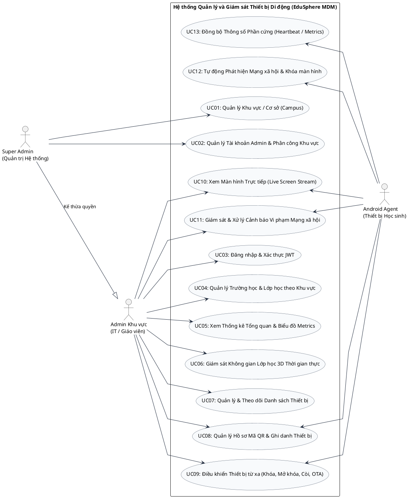

#### Hình 2.2. Sơ đồ Use Case theo vai trò

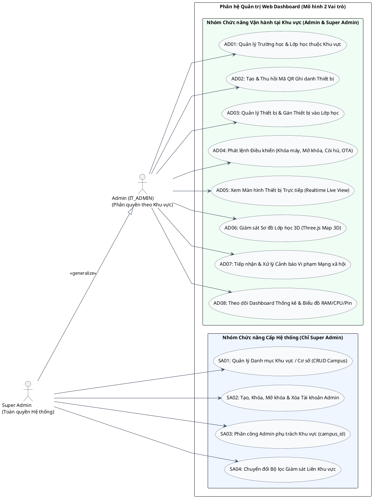

#### Hình 2.3. Sơ đồ Use Case của Agent và Tác nhân hệ thống

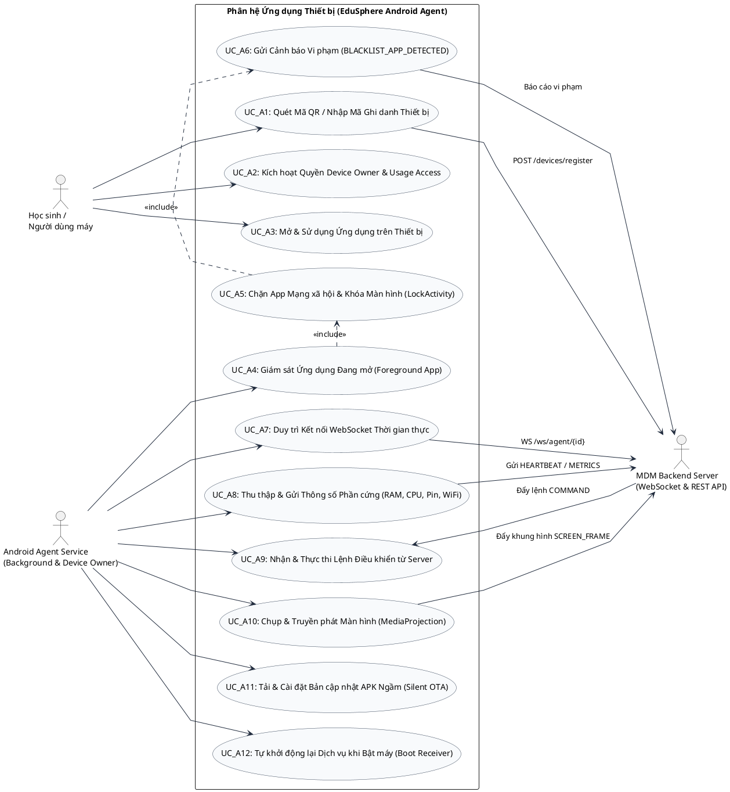

---

## 2.3. Kiến trúc tổng thể

### 2.3.1. Ba thành phần ứng dụng và hạ tầng dữ liệu

Hệ thống được thiết kế gồm ba phân hệ ứng dụng và hai tầng lưu trữ dữ liệu:
- **Android Agent (Kotlin, Clean Architecture + MVVM)**: Chạy thường trú trên thiết bị học sinh với đặc quyền Device Owner, thu thập chỉ số phần cứng, tự động phát hiện và khóa màn hình khi mở ứng dụng mạng xã hội bị cấm, truyền phát màn hình trực tiếp và thực thi lệnh điều khiển.
- **MDM Server (Python 3.12, FastAPI, SQLAlchemy 2.0 AsyncPG, Pure WebSocket)**: Cung cấp RESTful API phân quyền theo Khu vực (`Campus Scope RBAC`), quản lý kênh giao tiếp hai chiều Pure WebSocket thời gian thực với hàng trăm thiết bị, xử lý sự kiện vi phạm và điều phối lệnh.
- **Web Dashboard (React 18, TypeScript, Vite, Ant Design, Three.js)**: Giao diện quản trị tập trung và trực quan hóa không gian lớp học 3D dành cho `Super Admin` và `Admin Khu vực`.
- **PostgreSQL 16 (Persistent Relational & JSONB Storage)**: Lưu trữ bền vững dữ liệu tổ chức (`campuses`, `schools`, `classrooms`), tài khoản (`users`, `refresh_tokens`), thiết bị (`devices`, `enrollment_profiles`), lịch sử lệnh (`device_commands`), cảnh báo (`alerts`, `device_events`) và bản ghi lịch sử thông số (`device_metrics_snapshots`).
- **In-Memory Realtime Store (`ConnectionManager`)**: Lưu trữ trực tiếp trong bộ nhớ RAM của tiến trình máy chủ danh sách phiên kết nối WebSocket đang hoạt động (`agent_connections`, `dashboard_connections`), bộ đệm chỉ số phần cứng mới nhất (`latest_metrics`) và thông tin ứng dụng đang mở (`current_app`).

Việc kết hợp giữa **In-Memory Realtime Store** và **PostgreSQL 16** giúp tối ưu hóa hiệu năng: các thông số phần cứng (RAM, CPU, Pin) và khung hình màn hình (`SCREEN_FRAME`) thay đổi liên tục sau mỗi vài trăm mili-giây đến vài chục giây nên được giữ trong bộ nhớ đệm để phản hồi tức thời mà không gây nghẽn I/O cơ sở dữ liệu; cứ sau mỗi 10 chu kỳ nhận chỉ số (~5 phút/lần), `MetricsPersistenceService` mới trích xuất một bản chụp (`DeviceMetricsSnapshot`) lưu xuống PostgreSQL để phục vụ vẽ biểu đồ lịch sử dài hạn.

#### Hình 2.4. Sơ đồ kiến trúc hệ thống

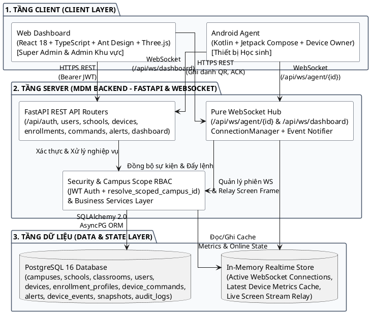

#### Hình 2.5. Sơ đồ kiến trúc hệ thống (tầng Server)

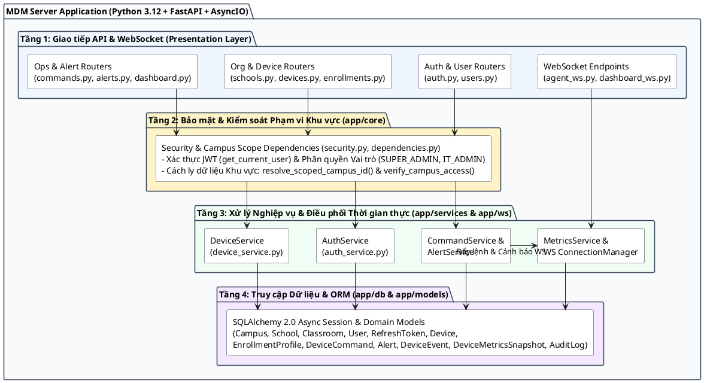

#### Hình 2.6. Sơ đồ kiến trúc hệ thống (tầng Client)

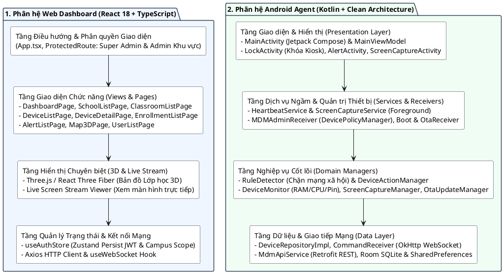

#### Hình 2.7. Sơ đồ kiến trúc hệ thống (tầng Data)

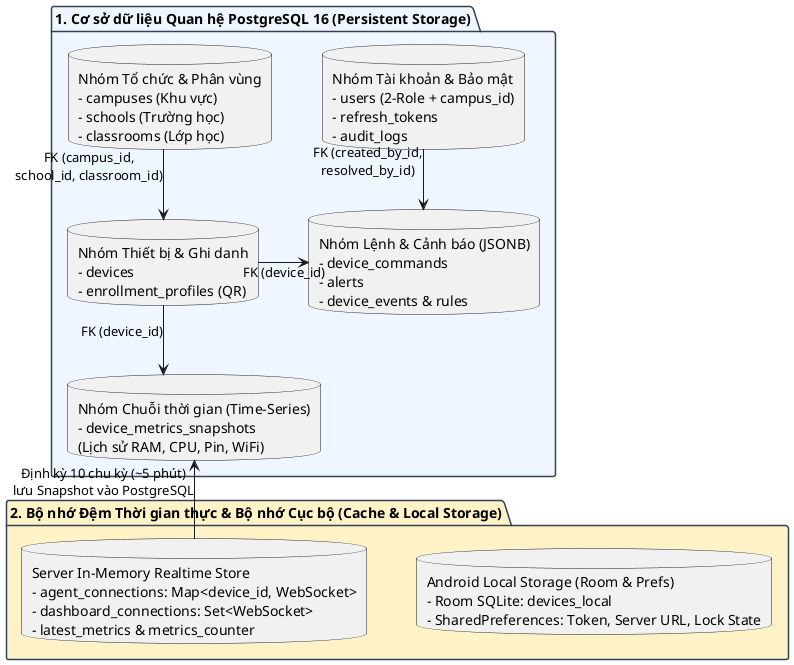

---

### 2.3.2. Bốn kênh giao tiếp

**Bảng 2.6. Bảng chi tiết các kênh giao tiếp trong hệ thống**

| Kênh | Hướng giao tiếp | Giao thức & Đường dẫn | Cơ chế xác thực | Nội dung truyền tải |
| :--- | :--- | :--- | :--- | :--- |
| **K1** | `Agent → Server` | REST (`/api/devices/register`, `/api/commands/{id}/ack`) & WebSocket (`/api/ws/agent/{device_id}`) | Query param `?token=<device_jwt>` (trừ endpoint `register`) | Ghi danh thiết bị, đẩy chỉ số `METRICS`, ứng dụng đang mở `CURRENT_APP`, báo cáo sự kiện vi phạm `EVENT` và xác nhận lệnh `COMMAND_ACK` |
| **K2** | `Server → Agent` | Pure WebSocket (`/api/ws/agent/{device_id}`) | Xác thực `device_jwt` khi bắt tay kết nối (`Handshake`) | Đẩy lệnh điều khiển tức thời (`COMMAND`), các lệnh đang chờ (`PENDING`) khi kết nối lại và đồng bộ chính sách (`SYNC_POLICIES`) |
| **K3** | `Agent → Server → Dashboard` | Pure WebSocket (`/api/ws/agent/{id}` chuyển tiếp sang `/api/ws/dashboard`) | `device_jwt` (phía Agent) & `access_jwt` (phía Dashboard) | Luồng khung hình chụp màn hình trực tiếp (`SCREEN_FRAME`) nén JPEG dạng chuỗi Base64 |
| **K4** | `Dashboard ↔ Server` | REST API (`/api/*`) & WebSocket (`/api/ws/dashboard`) | Header `Authorization: Bearer <access_jwt>` & Query `?token=<access_jwt>` | Thực hiện thao tác quản trị (lọc theo `campus_id`) và nhận thông báo thời gian thực (`DEVICE_STATUS`, `DEVICE_METRICS`, `NEW_ALERT`, `COMMAND_ACK`) |

---

### 2.3.3. Phân lớp Backend

Mã nguồn Backend (`mdm-server/app`) được tổ chức theo kiến trúc phân lớp rõ ràng:
- **`routers/` (Presentation Layer)**: Tiếp nhận HTTP Request, kiểm tra tính hợp lệ của dữ liệu đầu vào qua Pydantic Schemas (`schemas/`) và kích hoạt các Dependency kiểm tra phân quyền.
- **`core/` (Security & Campus Scope Layer)**: Chứa `security.py` (mã hóa mật khẩu Bcrypt, ký và giải mã JWT) và `dependencies.py` (xác thực người dùng hiện tại, kiểm tra vai trò `SUPER_ADMIN` / `IT_ADMIN`, và cưỡng chế cách ly dữ liệu theo Khu vực `campus_id`).
- **`services/` (Business Logic Layer)**: Chứa các lớp xử lý nghiệp vụ cốt lõi gồm `auth_service.py`, `device_service.py`, `command_service.py`, `alert_service.py` và `metrics_service.py`.
- **`ws/` (Realtime WebSocket Layer)**: Gồm `connection_manager.py` (quản lý kết nối và bộ đệm In-Memory), `notifier.py` (phát sóng sự kiện tới Dashboard), `agent_ws.py` (luồng giao tiếp với Android Agent) và `dashboard_ws.py` (luồng giao tiếp với trình duyệt quản trị).
- **`models/` & `db/` (Data Access Layer)**: Định nghĩa các thực thể ORM bằng SQLAlchemy 2.0 và quản lý phiên kết nối bất đồng bộ `AsyncSession` tới PostgreSQL.

---

## 2.4. Thiết kế hệ thống

### 2.4.1. Sơ đồ thực thể (Database Class Diagrams)

#### Hình 2.8. Class Diagram Tổ chức và Thiết bị (1)

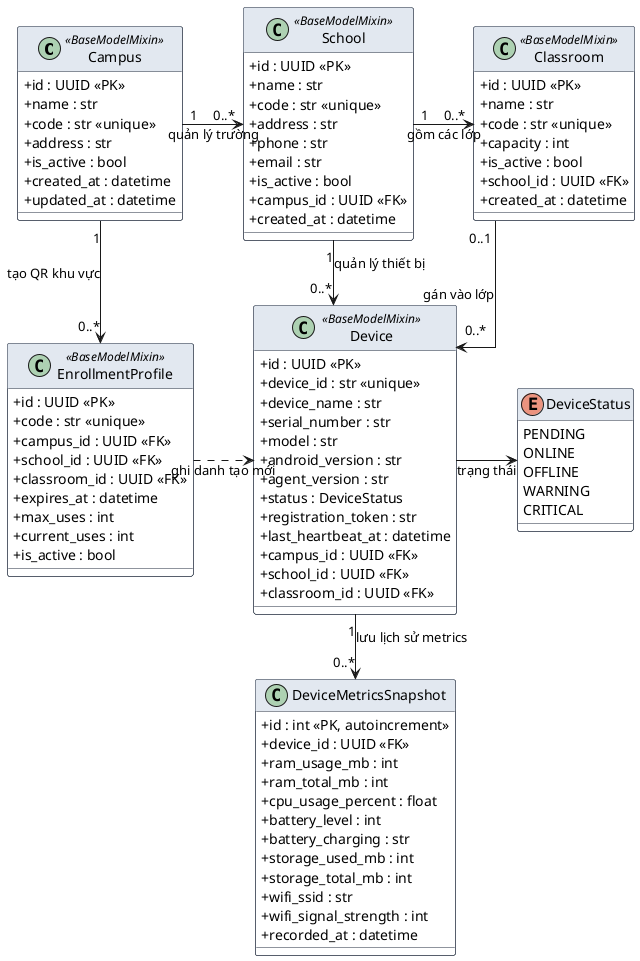

#### Hình 2.9. Class Diagram nhóm lệnh, cảnh báo và sự kiện (2)

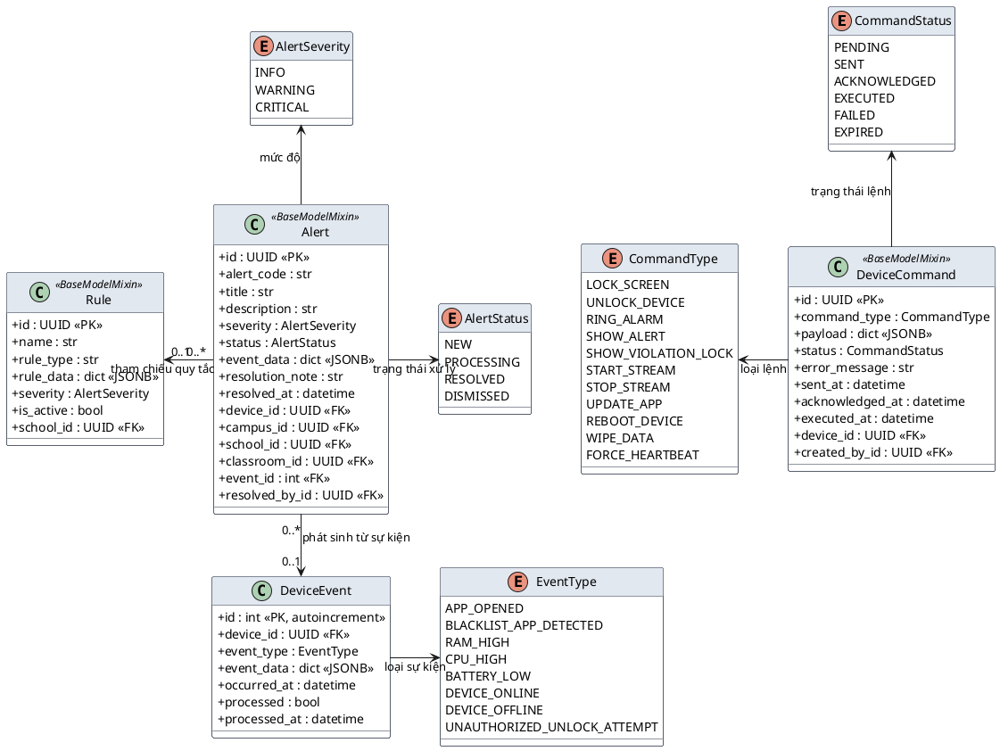

#### Hình 2.10. Class Diagram nhóm người dùng và nhật ký hệ thống (3)

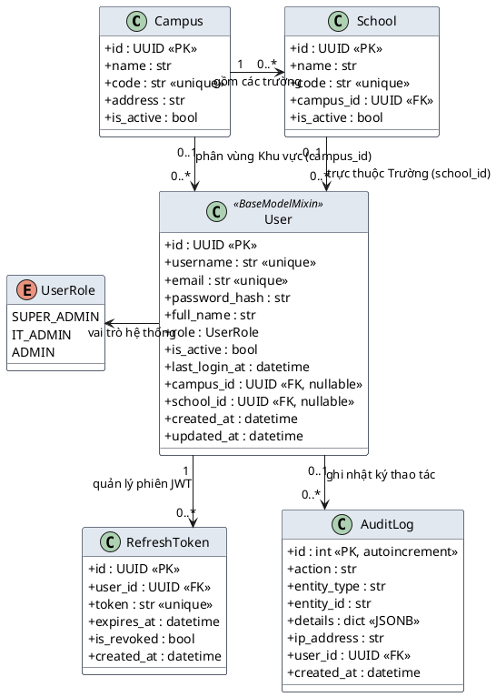

---

### 2.4.2. Sơ đồ hoạt động (Activity Diagram - Luồng xử lý)

#### 2.4.2.1. Sơ đồ hoạt động ghi danh thiết bị

#### Hình 2.11. Sơ đồ hoạt động luồng ghi danh thiết bị

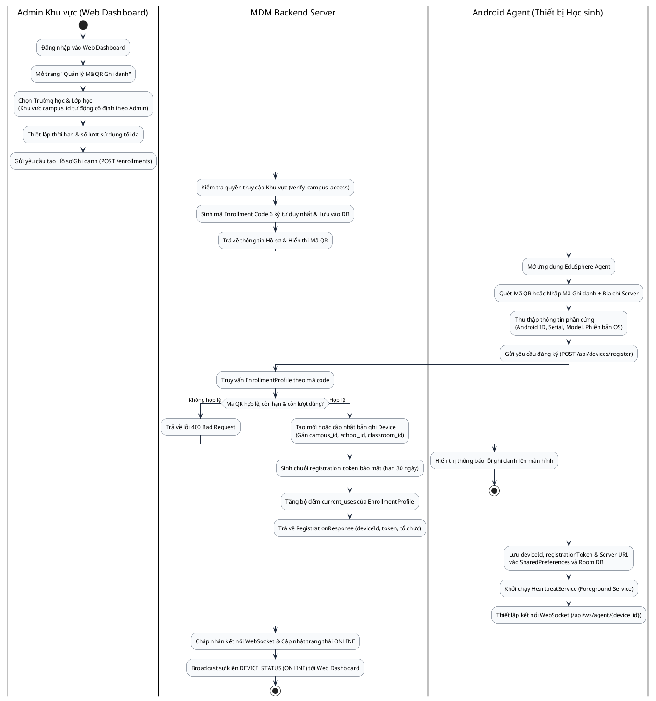

#### 2.4.2.2. Sơ đồ hoạt động phát hiện ứng dụng cấm và khóa màn hình tự động (Phía Agent)

#### Hình 2.12. Sơ đồ hoạt động phát hiện ứng dụng cấm và khóa màn hình tự động

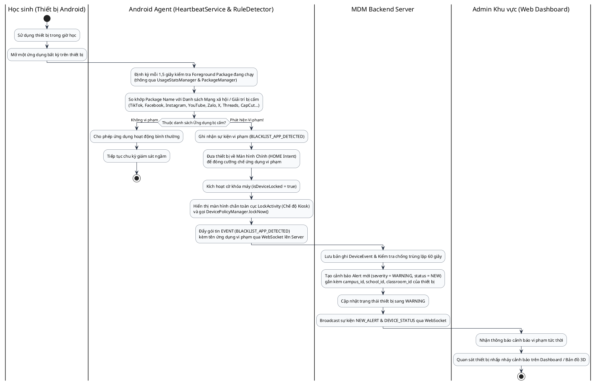

#### 2.4.2.3. Sơ đồ hoạt động điều khiển thiết bị từ xa và xử lý cảnh báo (Phía Quản trị)

#### Hình 2.13. Sơ đồ hoạt động điều khiển thiết bị từ xa và xử lý cảnh báo

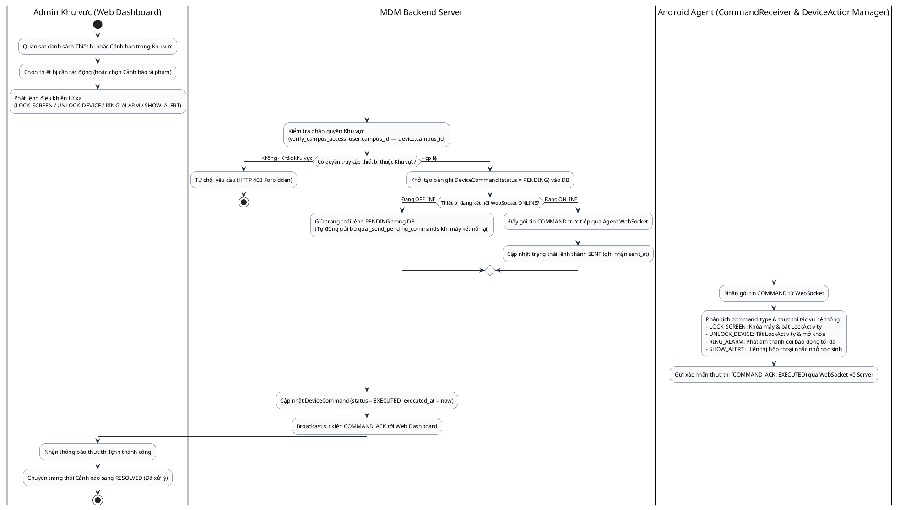

#### 2.4.2.4. Sơ đồ hoạt động quản lý và giám sát lớp học 3D

#### Hình 2.14. Sơ đồ hoạt động quản lý và giám sát lớp học 3D

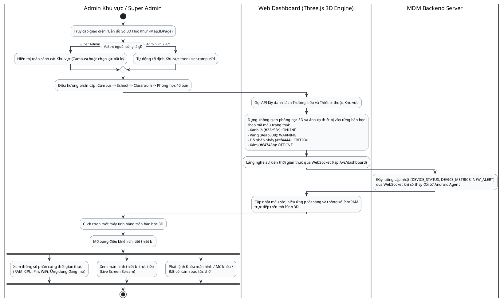

---

### 2.4.3. Sơ đồ tuần tự (Sequence Diagram - Giao tiếp hệ thống)

#### 2.4.3.1. Sơ đồ tuần tự cập nhật ứng dụng ngầm (OTA Update)

#### Hình 2.15. Sơ đồ tuần tự cập nhật ứng dụng ngầm

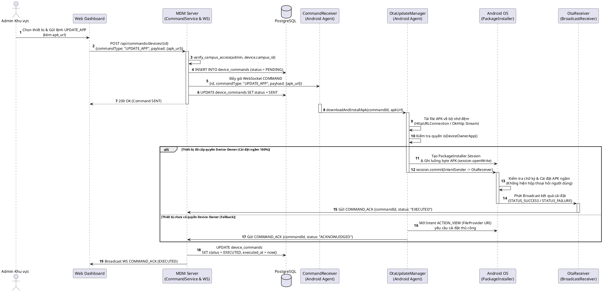

#### 2.4.3.2. Sơ đồ tuần tự truyền phát màn hình (Screen Mirroring)

#### Hình 2.16. Sơ đồ tuần tự truyền phát màn hình

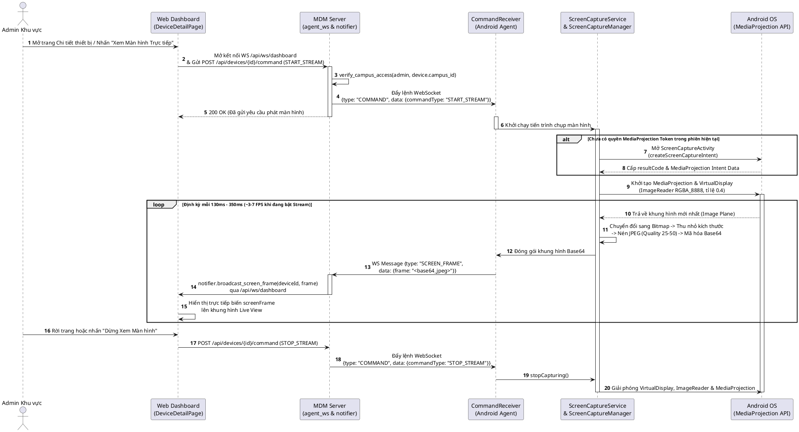

#### 2.4.3.3. Sơ đồ tuần tự đồng bộ thông số thời gian thực (Heartbeat & Metrics)

#### Hình 2.17. Sơ đồ tuần tự đồng bộ thông số thời gian thực

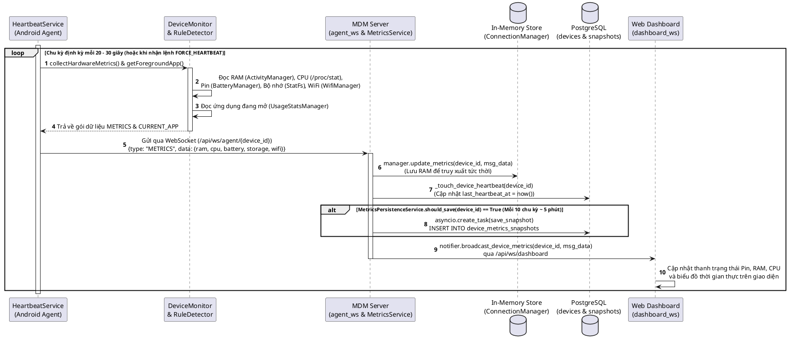

---

### 2.4.4. Sơ đồ lớp ứng dụng (Application Class Diagram)

#### 2.4.4.1. Sơ đồ lớp kiến trúc mã nguồn Backend (FastAPI)

#### Hình 2.18. Sơ đồ lớp kiến trúc mã nguồn Backend

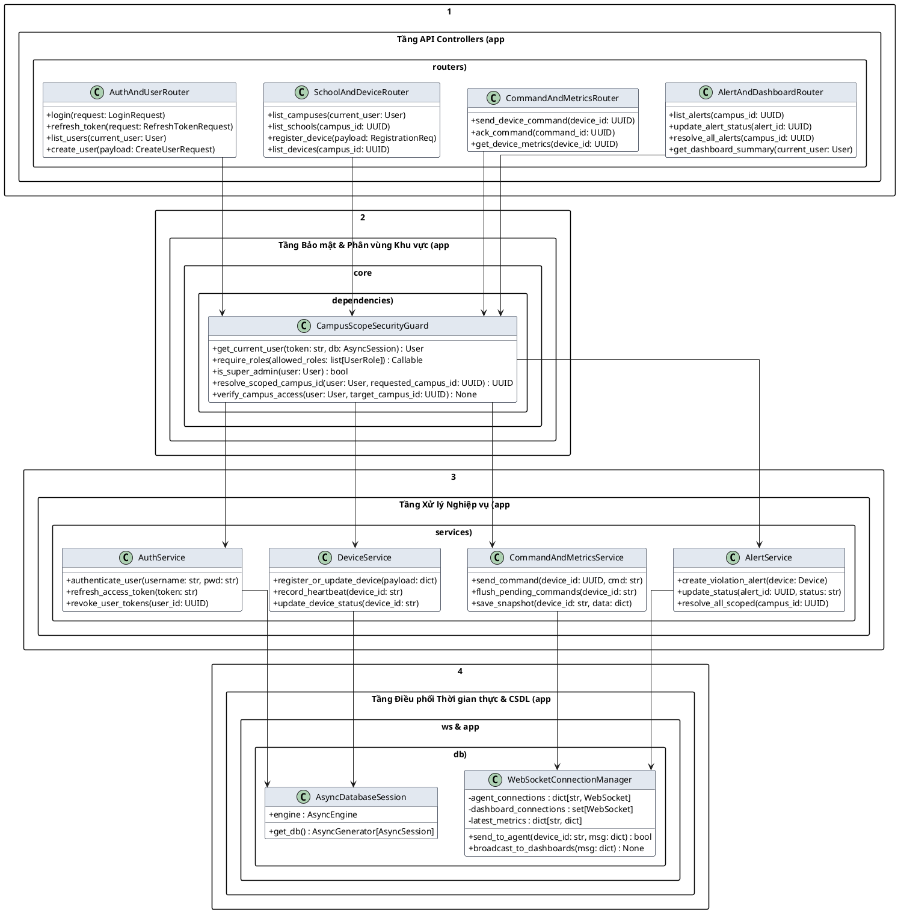

#### 2.4.4.2. Sơ đồ lớp kiến trúc mã nguồn Android Agent (Clean Architecture + MVVM)

#### Hình 2.19. Sơ đồ lớp kiến trúc mã nguồn Android Agent

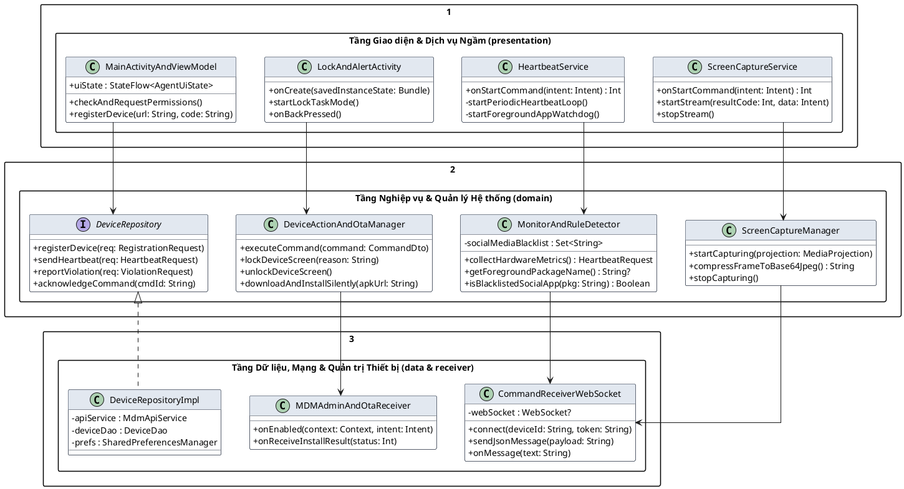

---

## 2.5. Thiết kế và cài đặt Backend

### 2.5.1. Xác thực và Quản lý phiên JWT

Mô-đun `app/core/security.py` sử dụng thuật toán `HS256` (HMAC-SHA256) với khóa bí mật giải mã từ Base64 (`settings.jwt_secret`) để phát hành ba loại JSON Web Token:

**Bảng 2.7. Bảng phân loại thời hạn và cấu trúc Token xác thực**

| Loại Token | Subject (`sub`) | Claims bổ sung | Thời hạn mặc định |
| :--- | :--- | :--- | :--- |
| **Access Token** | `username` | `role` (`SUPER_ADMIN` / `IT_ADMIN`), `userId` | 1 giờ (`3600` giây) |
| **Refresh Token** | `username` | `type="REFRESH"` | 7 ngày (`604800` giây) |
| **Device Token** | `device_id` (`ANDROID_ID`) | `type="DEVICE"` | 30 ngày (`2592000` giây) |

Tại tầng Dependency (`app/core/dependencies.py`):
- Hàm `get_current_user` giải mã `Bearer <access_token>`, truy vấn thực thể `User` từ PostgreSQL và kiểm tra cờ `user.is_active == True`. Nhờ đó, nếu một tài khoản Admin bị `Super Admin` khóa, mọi yêu cầu API tiếp theo sẽ bị chặn ngay lập tức với mã `401/403` ngay cả khi Access Token chưa hết hạn.
- Hàm `get_device_from_ws_token` kiểm tra `token` truyền qua Query Parameter khi `Android Agent` bắt tay kết nối WebSocket, đối chiếu `claim["type"] == "DEVICE"` và xác nhận `device.device_id` khớp với đường dẫn `/ws/agent/{device_id}`.
- Khi người dùng đăng xuất (`POST /api/auth/logout`) hoặc bị khóa tài khoản, hệ thống đánh dấu `is_revoked = True` đối với các bản ghi `RefreshToken` của người dùng đó trong bảng `refresh_tokens`, ngăn chặn việc tái sử dụng token cũ để làm mới phiên.

---

### 2.5.2. Cơ chế Phân quyền theo Khu vực (Campus Scope Isolation)

Để đảm bảo tính độc lập dữ liệu giữa các cơ sở trường học trong mô hình 2 vai trò, hệ thống triển khai ba hàm kiểm soát phạm vi tại `app/core/dependencies.py`:
1. **`is_super_admin(user: User) -> bool`**: Kiểm tra người dùng có vai trò `SUPER_ADMIN` hay không.
2. **`resolve_scoped_campus_id(current_user: User, requested_campus_id: Optional[UUID]) -> Optional[UUID]`**:
   - Nếu là `SUPER_ADMIN`: Trả về `requested_campus_id` (cho phép lọc theo cơ sở bất kỳ hoặc để trống `None` để xem toàn bộ hệ thống).
   - Nếu là `IT_ADMIN` / `ADMIN`: Bắt buộc kiểm tra tài khoản đã được gán `current_user.campus_id` chưa (nếu chưa gán thì ném lỗi `403 Forbidden`). Nếu request truyền `requested_campus_id` khác với `current_user.campus_id` thì lập tức từ chối (`403 Forbidden`); ngược lại luôn trả về `current_user.campus_id` ngay cả khi client không truyền tham số lọc.
3. **`verify_campus_access(current_user: User, target_campus_id: Optional[UUID]) -> None`**: Được gọi trước mọi thao tác xem chi tiết, chỉnh sửa, xóa hoặc gửi lệnh điều khiển tới một tài nguyên cụ thể (Trường học, Lớp học, Thiết bị, Mã QR, Cảnh báo), đảm bảo Admin của khu vực nào chỉ có thể tác động lên tài nguyên của đúng khu vực đó.

---

### 2.5.3. Đăng ký thiết bị và Mã ghi danh (QR Enrollment)

Tại `app/routers/enrollments.py`, khi Admin tạo hồ sơ ghi danh mới, hệ thống kiểm tra quyền truy cập khu vực (`verify_campus_access`), sau đó sinh chuỗi mã gồm 6 ký tự chữ và số in hoa duy nhất (ví dụ: `A8F9K2`), lưu vào bảng `enrollment_profiles` với thời hạn mặc định 7 ngày và `max_uses = 0` (không giới hạn số thiết bị quét). Khi thu hồi mã, hệ thống thực hiện xóa mềm (`is_active = False`).

Khi `Android Agent` gọi `POST /api/devices/register` (`app/services/device_service.py`), quy trình xử lý diễn ra như sau:
1. Tìm thiết bị theo `device_id` (`ANDROID_ID`). Nếu thiết bị đã tồn tại trong bảng `devices`, cập nhật lại thông tin phần cứng (`model`, `android_version`, `agent_version`, `serial_number`); nếu chưa có, khởi tạo thực thể `Device` mới.
2. Nếu kèm theo `enrollmentCode`: Truy vấn bảng `enrollment_profiles`, kiểm tra mã có tồn tại, `is_active == True`, chưa quá hạn `expires_at` và `current_uses < max_uses` (nếu `max_uses > 0`). Khi hợp lệ, hệ thống tự động gán `campus_id`, `school_id`, `classroom_id` từ hồ sơ mã QR sang thiết bị, chuyển trạng thái thiết bị sang `ONLINE` và tăng `current_uses` thêm 1.
3. Phát hành `Device Token` (JWT hạn 30 ngày), lưu vào cột `devices.registration_token` và trả về `DeviceRegistrationResponse` chứa token, tên Khu vực/Trường/Lớp cùng đường dẫn kết nối WebSocket (`ws_url`).

---

### 2.5.4. Xử lý Heartbeat, Metrics và Phát hiện Offline tức thời

Thay vì sử dụng cơ chế Polling kết hợp Job quét Redis TTL có độ trễ 60–90 giây như kiến trúc cũ, hệ thống hiện tại sử dụng kênh kết nối **Pure WebSocket** tại `app/ws/agent_ws.py`:
1. **Khi Agent kết nối (`/api/ws/agent/{device_id}`)**: Sau khi xác thực token hợp lệ, máy chủ đăng ký kết nối vào `ConnectionManager`, cập nhật cột `devices.status = "ONLINE"` trong PostgreSQL và phát sóng sự kiện `DEVICE_STATUS` (`ONLINE`) tới toàn bộ trình duyệt Dashboard đang mở.
2. **Khi nhận gói tin `METRICS` và `CURRENT_APP` định kỳ**:
   - Cập nhật ngay lập tức vào bộ nhớ đệm `manager.update_metrics(device_id, msg_data)` và `manager.update_current_app(device_id, msg_data)`.
   - Chuyển tiếp (broadcast) trực tiếp lên `/api/ws/dashboard` để giao diện cập nhật thanh RAM, CPU, Pin và biểu tượng ứng dụng đang mở theo thời gian thực.
   - Gọi `_touch_device_heartbeat(device_id)` để cập nhật mốc `last_heartbeat_at = now()` (nhưng giữ nguyên trạng thái nếu máy đang ở mức cảnh báo `WARNING` hoặc `CRITICAL`).
   - Kiểm tra `MetricsPersistenceService.should_save(device_id)`: cứ mỗi 10 lần nhận chỉ số (và ngay ở lần đầu tiên sau khi kết nối), hệ thống tạo một tác vụ nền bất đồng bộ (`asyncio.create_task`) ghi bản ghi `DeviceMetricsSnapshot` vào PostgreSQL mà không làm nghẽn vòng lặp đọc WebSocket.
3. **Khi Agent mất kết nối (`WebSocketDisconnect`)**: Khối `finally` của endpoint WebSocket được kích hoạt ngay lập tức, xóa kết nối khỏi `ConnectionManager`, giải phóng bộ đếm `MetricsPersistenceService`, cập nhật `devices.status = "OFFLINE"` trong PostgreSQL và phát sóng trạng thái `OFFLINE` lên Dashboard với độ trễ gần như bằng 0.

---

### 2.5.5. Điều phối lệnh từ xa và Đồng bộ trạng thái ACK

Luồng điều phối lệnh trong `app/services/command_service.py` và `app/ws/agent_ws.py` giải quyết triệt để bài toán thiết bị ngoại tuyến và bài toán xác nhận lệnh (`ACK`):
1. Khi Admin gửi lệnh điều khiển, hệ thống kiểm tra `verify_campus_access(current_user, device.campus_id)`, sau đó tạo bản ghi `DeviceCommand` trong PostgreSQL với trạng thái khởi tạo `PENDING`.
2. **Trường hợp thiết bị đang `ONLINE`** (có mặt trong `manager.agent_connections`): Máy chủ đẩy trực tiếp gói JSON `{"type": "COMMAND", "data": {"id": ..., "commandType": ..., "payload": ...}}` xuống WebSocket của thiết bị và cập nhật ngay trạng thái lệnh sang `SENT` (kèm mốc thời gian `sent_at`).
3. **Trường hợp thiết bị đang `OFFLINE`**: Bản ghi lệnh được giữ ở trạng thái `PENDING` trong bảng `device_commands`. Ngay khi thiết bị kết nối lại vào WebSocket `/api/ws/agent/{device_id}`, hàm `_send_pending_commands(device_id, websocket)` tự động truy vấn toàn bộ các lệnh `PENDING` của thiết bị đó, đẩy tuần tự xuống Agent và chuyển trạng thái sang `SENT`.
4. **Xác nhận thực thi (`COMMAND_ACK`)**: Sau khi `Android Agent` thực thi xong lệnh, Agent gửi gói tin `{"type": "COMMAND_ACK", "data": {"commandId": ..., "status": "EXECUTED"}}` qua WebSocket (hoặc gọi `POST /api/commands/{id}/ack`). Hàm `_handle_command_ack` cập nhật trạng thái lệnh trong DB thành `EXECUTED` (ghi nhận `executed_at = now()`) và thông báo lên Dashboard. Nhờ vậy, mỗi lệnh đều đi trọn vẹn vòng đời `PENDING → SENT → EXECUTED` mà không bị lặp lệnh.

**Bảng 2.8. Đối chiếu các loại lệnh điều khiển (`CommandType`) giữa Server và Android Agent**

| `CommandType` | Mô tả tác vụ | Hàm xử lý trên `Android Agent` (`DeviceActionManager.kt`) |
| :--- | :--- | :--- |
| **`LOCK_SCREEN`** | Khóa màn hình thiết bị từ xa và bật giao diện khóa Kiosk | `lockScreen()` (`dpm.lockNow()` + khởi chạy `LockActivity`) |
| **`UNLOCK_DEVICE`** | Mở khóa thiết bị từ xa, thoát chế độ Kiosk | `unlockDevice()` (Đặt `isDeviceLocked = false` + phát Broadcast đóng `LockActivity`) |
| **`RING_ALARM`** | Phát còi báo động âm lượng tối đa kèm thông báo | `ringAlarm()` (Tăng `AudioManager` lên mức tối đa + phát chuông 10 giây) |
| **`SHOW_ALERT`** | Hiển thị hộp thoại thông báo/nhắc nhở trên màn hình học sinh | `showAlert()` (Khởi chạy `AlertActivity` với thông điệp từ Admin) |
| **`SHOW_VIOLATION_LOCK`** | Khóa màn hình kèm cảnh báo vi phạm quy định sử dụng máy | Khởi chạy `LockActivity` hiển thị lý do vi phạm |
| **`START_STREAM` / `STOP_STREAM`** | Bắt đầu hoặc dừng truyền phát màn hình trực tiếp | Kích hoạt / dừng `ScreenCaptureService` (`MediaProjection`) |
| **`CLEAR_BACKGROUND_APPS`** | Dọn dẹp các tiến trình chạy ngầm giải phóng RAM | `clearRam()` (`ActivityManager.killBackgroundProcesses`) |
| **`OPEN_APP` / `OPEN_URL`** | Mở một ứng dụng theo Package Name hoặc mở trang web bài giảng | `openApp()`, `openUrl()` (`Intent.ACTION_VIEW`) |
| **`HIDE_APP` / `BLOCK_UNINSTALL`** | Ẩn ứng dụng khỏi Launcher hoặc chặn gỡ cài đặt | `dpm.setApplicationHidden()`, `dpm.setUninstallBlocked()` |
| **`DISABLE_CAMERA` / `DISABLE_FACTORY_RESET`** | Vô hiệu hóa máy ảnh hoặc chặn khôi phục cài đặt gốc | `dpm.setCameraDisabled()`, `UserManager.DISALLOW_FACTORY_RESET` |
| **`REBOOT_DEVICE` / `WIPE_DATA`** | Khởi động lại thiết bị hoặc xóa trắng dữ liệu về mặc định | `dpm.reboot()`, `dpm.wipeData(0)` (Yêu cầu quyền Device Owner) |
| **`UPDATE_APP`** | Tải và cài đặt bản cập nhật APK ngầm từ xa | `OtaUpdateManager.downloadAndInstallApk()` (`PackageInstaller`) |

---

### 2.5.6. Phát hiện vi phạm ứng dụng cấm và Trung tâm Cảnh báo

Khi học sinh mở một ứng dụng nằm trong danh sách mạng xã hội hoặc giải trí bị cấm, `Android Agent` lập tức cưỡng chế thoát ứng dụng, khóa màn hình thiết bị ngay tại chỗ để đảm bảo tính tức thời (Zero-latency enforcement), đồng thời gửi gói tin `EVENT` (`eventType = "BLACKLIST_APP_DETECTED"`) hoặc `UNAUTHORIZED_UNLOCK_ATTEMPT` (khi nhập sai mã PIN mở khóa nhiều lần) lên máy chủ.

Tại máy chủ (`_handle_event` trong `app/ws/agent_ws.py`), quy trình xử lý diễn ra theo 4 bước:
1. Lưu sự kiện gốc vào bảng `device_events` (`processed = True`).
2. **Kiểm tra chống trùng lặp (Anti-spam 60 giây)**: Truy vấn bảng `alerts` xem trong vòng 60 giây gần nhất thiết bị này đã có cảnh báo nào cùng mã `alert_code` đang ở trạng thái `NEW` hoặc `PROCESSING` hay chưa. Nếu đã có thì bỏ qua việc tạo mới để tránh làm ngập bảng cảnh báo.
3. **Phân loại mức độ nghiêm trọng và cập nhật trạng thái máy**:
   - Với `BLACKLIST_APP_DETECTED`: Tạo cảnh báo mức `WARNING` (*"Mở ứng dụng bị cấm: <Tên ứng dụng>"*) và chuyển trạng thái thiết bị sang `WARNING`.
   - Với `UNAUTHORIZED_UNLOCK_ATTEMPT`: Tạo cảnh báo mức `CRITICAL` (*"Cố tình mở khóa trái phép"*) và chuyển trạng thái thiết bị sang `CRITICAL`.
   - Bản ghi `Alert` tự động kế thừa `campus_id`, `school_id`, `classroom_id` của thiết bị để phân vùng về đúng Khu vực quản lý.
4. **Phát sóng thời gian thực & Khôi phục trạng thái**: Đẩy sự kiện `NEW_ALERT` và `DEVICE_STATUS` qua WebSocket tới Dashboard. Khi Admin xử lý xong cảnh báo (`PATCH /api/alerts/{id}/status` chuyển sang `RESOLVED` hoặc `PUT /api/alerts/resolve-all` trong `alert_service.py`), hệ thống kiểm tra nếu thiết bị không còn cảnh báo nào đang mở (`NEW`/`PROCESSING`) thì tự động khôi phục trạng thái thiết bị về `ONLINE`.

---

### 2.5.7. Thống kê Dashboard theo phạm vi Khu vực

Tại `app/routers/dashboard.py`, hàm `_build_summary(db, current_user)` tổng hợp dữ liệu cho trang Tổng quan. Điểm cải tiến quan trọng so với phiên bản cũ là toàn bộ câu lệnh thống kê (`total_devices`, phân bố trạng thái `ONLINE`/`OFFLINE`/`WARNING`/`CRITICAL`, số lượng cảnh báo chưa xử lý `active_alerts` và chuỗi dữ liệu biểu đồ 7 ngày `recent_alerts`) đều được áp bộ lọc `campus_id == current_user.campus_id` khi người dùng không phải là `SUPER_ADMIN`. Chỉ số an toàn hệ thống (`safetyIndex`) được tính theo công thức:
$$\text{Safety Index} = \max\left(0, \text{round}\left(100 - \frac{\text{warning} + \text{critical}}{\text{total\_devices}} \times 100\right)\right)$$

---

## 2.6. Thiết kế và cài đặt Android Agent

### 2.6.1. Cấu trúc thành phần

**Bảng 2.9. Bảng thành phần cấu trúc mã nguồn Android Agent**

| Thành phần | Vai trò và chức năng chính |
| :--- | :--- |
| **`MainActivity.kt` & `MainViewModel.kt`** | Giao diện chính (Jetpack Compose) để nhập hoặc quét mã QR ghi danh (`Enrollment Code`), kiểm tra và yêu cầu cấp các quyền hệ thống (`Device Admin`, `Usage Stats`, `Overlay`, `MediaProjection`). Tích hợp hộp thoại xác thực mã PIN bảo mật để tạm dừng giám sát hoặc gỡ quyền Device Owner khi bảo trì. |
| **`di/AppModule.kt` & `RepositoryModule.kt`** | Cấu hình Hilt Dependency Injection, khởi tạo các đối tượng Singleton như `OkHttpClient`, `Retrofit`, `DynamicBaseUrlInterceptor` (cho phép đổi IP Server linh hoạt không cần biên dịch lại APK) và `AppDatabase` (Room). |
| **`data/remote/websocket/CommandReceiver.kt`** | Quản lý kết nối Pure WebSocket với máy chủ (`/api/ws/agent/{device_id}`), tự động kết nối lại khi rớt mạng, lắng nghe các gói lệnh `COMMAND` và `SYNC_POLICIES` để chuyển giao cho `DeviceActionManager`. |
| **`domain/monitor/DeviceMonitor.kt`** | Thu thập thông số phần cứng theo thời gian thực: dung lượng RAM (`ActivityManager`), tải CPU, mức Pin và trạng thái sạc (`BatteryManager`), bộ nhớ lưu trữ (`StatFs`), cường độ tín hiệu Wi-Fi (`WifiManager`) và nhận diện ứng dụng đang mở qua `UsageStatsManager`. |
| **`domain/rule/RuleDetector.kt`** | Bộ lọc phát hiện vi phạm chủ động trên thiết bị. Kết hợp danh sách đen các ứng dụng mạng xã hội/giải trí phổ biến (TikTok, Facebook, Instagram, YouTube, Messenger, Zalo, Threads, X/Twitter, Discord, CapCut...) và phân loại danh mục ứng dụng (`ApplicationInfo.CATEGORY_GAME`, `CATEGORY_SOCIAL`) để phát hiện tức thời hành vi mở ứng dụng trái phép. |
| **`domain/action/DeviceActionManager.kt`** | Lớp nghiệp vụ thực thi các lệnh điều khiển cấp hệ thống thông qua `DevicePolicyManager`: khóa màn hình (`lockNow` + `LockActivity`), mở khóa, hú còi báo động, dọn RAM, ẩn ứng dụng, khóa Camera, khởi động lại hoặc xóa dữ liệu. |
| **`domain/screen/ScreenCaptureManager.kt`** | Quản lý phiên chụp màn hình qua `MediaProjection` và `VirtualDisplay`, đọc khung hình từ `ImageReader`, thu phóng kích thước, nén thành ảnh JPEG và mã hóa Base64 để phát trực tiếp lên Web Dashboard. |
| **`domain/action/OtaUpdateManager.kt`** | Tải tệp cài đặt APK từ đường dẫn máy chủ và thực hiện cài đặt ngầm không cần tương tác người dùng (Silent Install) thông qua `PackageInstaller.Session`. |
| **`presentation/service/HeartbeatService.kt`** | Foreground Service chạy xuyên suốt giúp Agent không bị hệ điều hành đóng băng (Doze Mode), duy trì vòng lặp gửi chỉ số phần cứng mỗi 20 giây và vòng lặp canh gác ứng dụng đang mở mỗi 1,5 giây. |
| **`receiver/MDMAdminReceiver.kt`, `BootCompletedReceiver.kt`, `OtaReceiver.kt`** | Các Broadcast Receiver lắng nghe sự kiện quản trị thiết bị (`DeviceAdminReceiver`), tự động khởi chạy lại dịch vụ khi bật nguồn máy (`BOOT_COMPLETED`) và nhận kết quả cài đặt gói APK ngầm (`PackageInstaller`). |

---

### 2.6.2. Hoạt động cốt lõi và Cơ chế chạy ngầm

Để đảm bảo `Android Agent` hoạt động bền bỉ trên hệ điều hành Android 10 trở lên mà không bị trình tiết kiệm pin tiêu diệt, ứng dụng kết hợp bốn cơ chế:
1. **Dịch vụ tiền cảnh (`Foreground Service`)**: Cả `HeartbeatService` và `ScreenCaptureService` đều chạy với thông báo ghim cố định (`Notification`) trên thanh trạng thái cùng kiểu dịch vụ `connectedDevice` / `mediaProjection`, báo cho nhân Android biết đây là tiến trình hệ thống đang hoạt động.
2. **Tự động khởi động cùng hệ thống (`Auto-Start on Boot`)**: Ngay khi học sinh bật nguồn hoặc khởi động lại thiết bị, `BootCompletedReceiver` bắt sự kiện `ACTION_BOOT_COMPLETED` để kích hoạt lại `HeartbeatService` và khôi phục kết nối WebSocket.
3. **Canh gác ứng dụng thời gian thực (`Foreground App Watchdog`)**: Trong `HeartbeatService`, một Coroutine độc lập quét ứng dụng đang hiển thị trên màn hình mỗi 1,5 giây thông qua `RuleDetector`.
4. **Cưỡng chế khóa màn hình tức thời (`Active Social Media Blocking & Lock`)**: Ngay khi phát hiện ứng dụng mạng xã hội bị cấm hoặc khi nhận lệnh `LOCK_SCREEN` từ quản trị viên, Agent lập tức:
   - Đẩy `Intent.ACTION_MAIN` (`CATEGORY_HOME`) để ép thiết bị thoát khỏi ứng dụng vi phạm.
   - Ghi trạng thái khóa (`isDeviceLocked = true`) vào bộ nhớ cục bộ.
   - Khởi chạy màn hình chắn toàn cục `LockActivity` ở chế độ `LockTask` (Kiosk) đồng thời gọi `DevicePolicyManager.lockNow()`, khiến học sinh không thể tiếp tục thao tác cho đến khi được Admin mở khóa từ xa (hoặc nhập đúng mã PIN khẩn cấp của quản trị viên).

---

### 2.6.3. Các giao diện hiển thị cưỡng chế (UI Overlays)

Hệ thống sử dụng các `Activity` đặc biệt với cờ ưu tiên cửa sổ hệ thống để đè lên mọi ứng dụng khác:
- **`LockActivity.kt` (Màn hình Khóa vi phạm / Khóa từ xa)**: Sử dụng các cờ `FLAG_SHOW_WHEN_LOCKED`, `FLAG_DISMISS_KEYGUARD`, `FLAG_KEEP_SCREEN_ON`, `FLAG_FULLSCREEN` kết hợp chế độ ghim màn hình `startLockTask()`. Giao diện chặn hoàn toàn phím Back và thanh điều hướng, hiển thị thông báo thiết bị đã bị khóa bởi hệ thống quản trị trường học và cung cấp ô nhập mã PIN dự phòng để mở khóa ngoại tuyến khi mất kết nối mạng.
- **`AlertActivity.kt` (Màn hình Cảnh báo & Còi báo động)**: Sử dụng chủ đề hộp thoại nổi kèm cờ đánh thức màn hình, tự động đẩy âm lượng kênh `STREAM_ALARM` / `STREAM_MUSIC` của `AudioManager` lên mức tối đa để phát âm thanh cảnh báo ngay cả khi học sinh gạt máy sang chế độ im lặng.
- **`ScreenCaptureActivity.kt`**: Activity trong suốt (`Transparent Theme`) chỉ xuất hiện trong tích tắc để nhận sự đồng ý cấp quyền `MediaProjection` từ hệ thống, sau đó chuyển giao `resultCode` và `Intent` cho `ScreenCaptureService` xử lý ngầm.

---

### 2.6.4. Cơ chế thực thi lệnh hệ thống trên thiết bị

**Bảng 2.10. Cơ chế thực thi các nhóm lệnh từ xa trên Android Agent**

| Nhóm lệnh từ xa | Cơ chế thực thi chi tiết trên `Android Agent` |
| :--- | :--- |
| **Khóa & Mở khóa (`LOCK_SCREEN`, `UNLOCK_DEVICE`)** | Khi nhận `LOCK_SCREEN`: lưu cờ khóa máy, phát Intent về màn hình Home, mở `LockActivity` ở chế độ Kiosk và gọi `dpm.lockNow()`. Khi nhận `UNLOCK_DEVICE`: xóa cờ khóa máy và phát Broadcast cục bộ `ACTION_UNLOCK_DEVICE` để `LockActivity` tự gọi `stopLockTask()` và `finish()`. |
| **Còi hú & Nhắc nhở (`RING_ALARM`, `SHOW_ALERT`)** | Mở `AlertActivity`, khởi tạo `MediaPlayer` phát tệp âm thanh cảnh báo ở mức âm lượng cao nhất trong 10 giây và hiển thị nội dung tin nhắn của quản trị viên. |
| **Truyền phát màn hình (`START_STREAM`, `STOP_STREAM`)** | Kích hoạt `ScreenCaptureService` -> Tạo `VirtualDisplay` từ `MediaProjection` -> Chụp khung hình qua `ImageReader` -> Thu nhỏ tỉ lệ `0.4`, nén JPEG, mã hóa Base64 -> Đẩy gói `SCREEN_FRAME` liên tục qua WebSocket cho tới khi nhận `STOP_STREAM`. |
| **Dọn dẹp bộ nhớ (`CLEAR_BACKGROUND_APPS`)** | Lặp qua danh sách các ứng dụng đang chạy nền không thuộc gói hệ thống và gọi `ActivityManager.killBackgroundProcesses(packageName)` để giải phóng RAM. |
| **Quản trị chính sách (`HIDE_APP`, `DISABLE_CAMERA`, `WIPE_DATA`)** | Giao tiếp trực tiếp với `DevicePolicyManager` thông qua `ComponentName(context, MDMAdminReceiver::class.java)` để ẩn ứng dụng, tắt máy ảnh hoặc khôi phục cài đặt gốc (`wipeData(0)`). |
| **Cập nhật ngầm (`UPDATE_APP`)** | Tải tệp APK từ URL về thư mục tạm -> Khởi tạo `PackageInstaller.Session` -> Ghi luồng dữ liệu APK và gọi `session.commit()` -> `OtaReceiver` nhận kết quả từ hệ điều hành và gửi `COMMAND_ACK` (`EXECUTED`) về máy chủ. |

---

## 2.7. Thiết kế và cài đặt Web Dashboard

### 2.7.1. Cấu trúc mã nguồn Frontend

**Bảng 2.11. Bảng thành phần cấu trúc mã nguồn Web Dashboard (`web-dashboard/src`)**

| Thành phần | Vai trò và chức năng chính |
| :--- | :--- |
| **`main.tsx`** | Khởi tạo `QueryClientProvider` (React Query với `refetchOnWindowFocus: false`), `ConfigProvider` (Ant Design Dark Theme tùy biến theo `themeConfig.ts`) và `BrowserRouter`. |
| **`App.tsx`** | Định nghĩa bố cục chính (`MainLayout`) với thanh điều hướng bên trái (`Sider`) được phân nhóm khoa học (*Tổng quan & Giám sát*, *Thiết bị & Điều khiển*, *Quản lý Tổ chức*, *Quản trị Hệ thống*) và hiển thị linh hoạt theo mô hình 2 vai trò (`Super Admin` và `Admin`). |
| **`routes/ProtectedRoute.tsx`** | Bảo vệ các tuyến đường yêu cầu xác thực; tự động chuyển hướng người dùng chưa đăng nhập về trang `/login`. |
| **`store/authStore.ts`** | Quản lý trạng thái đăng nhập toàn cục bằng `Zustand` kết hợp middleware `persist`, lưu trữ `accessToken`, `refreshToken` và thông tin `user` (bao gồm `role` và `campusId`) vào `localStorage`. |
| **`config/axios.ts`** | Cấu hình Axios Instance tự động đính kèm Header `Authorization: Bearer <token>`; tích hợp Interceptor tự động gọi `/api/auth/refresh` khi gặp mã lỗi `401 Unauthorized` để gia hạn phiên liền mạch. |
| **`hooks/useWebSocket.ts`** | Quản lý kết nối Pure WebSocket tới `/api/ws/dashboard?token=<jwt>`, tự động kết nối lại sau 5 giây nếu đứt mạng, phân loại các gói tin `DEVICE_STATUS`, `DEVICE_METRICS`, `CURRENT_APP`, `SCREEN_FRAME`, `NEW_ALERT` để cập nhật giao diện tức thời. |
| **`features/*`** | Các phân hệ giao diện chia theo miền nghiệp vụ: `auth`, `dashboard`, `devices`, `alerts`, `schools` (gồm Campus, School, Classroom), `users`, `map3d`, `profile`. |

---

### 2.7.2. Điều hướng và Phân quyền giao diện (Mô hình 2 Vai trò)

Sau khi loại bỏ hoàn toàn Teacher Portal rời rạc và hợp nhất về mô hình 2 vai trò, cấu trúc định tuyến và phân quyền trên `Web Dashboard` và `Backend API` được chuẩn hóa như trong Bảng 2.12:

**Bảng 2.12. Ma trận phân quyền giao diện và phạm vi dữ liệu theo 2 vai trò**

| Đường dẫn Route | Chức năng màn hình | `SUPER_ADMIN` | `IT_ADMIN` / `ADMIN` | Cơ chế giới hạn phạm vi dữ liệu |
| :--- | :--- | :---: | :---: | :--- |
| **`/`** | Dashboard Tổng quan | ✔ | ✔ | `SUPER_ADMIN` xem toàn cục; `ADMIN` tự động lọc số liệu theo `user.campusId` |
| **`/map3d`** | Bản đồ Số 3D Học Khu | ✔ | ✔ | `SUPER_ADMIN` duyệt từ cấp Campus; `ADMIN` mặc định mở thẳng Khu vực `user.campusId` |
| **`/devices`** | Danh sách Thiết bị & Điều khiển | ✔ | ✔ | `ADMIN` chỉ xem, sửa, gán lớp và điều khiển thiết bị thuộc `user.campusId` |
| **`/devices/:id`** | Chi tiết Thiết bị & Live Screen View | ✔ | ✔ | Kiểm tra `verify_campus_access`; chặn `403` nếu thiết bị khác Khu vực |
| **`/enrollments`** | Quản lý Mã Ghi Danh (QR Code) | ✔ | ✔ | Modal tạo QR của `ADMIN` tự động khóa cứng ô chọn Khu vực vào `user.campusId` |
| **`/alerts`** | Trung tâm Cảnh báo Vi phạm | ✔ | ✔ | Ẩn bộ lọc *"Tất cả Cơ sở"* đối với `ADMIN`; chỉ hiển thị và xử lý cảnh báo trong Khu vực |
| **`/schools`** | Quản lý Trường học | ✔ | ✔ | Ẩn bộ lọc chọn cơ sở khác đối với `ADMIN`; chỉ CRUD trường thuộc Khu vực của mình |
| **`/classrooms`** | Quản lý Lớp học | ✔ | ✔ | Chỉ hiển thị và quản lý các lớp học thuộc các trường trong Khu vực của `ADMIN` |
| **`/campuses`** | Quản lý Danh mục Khu vực (Campus) | ✔ | — | Chỉ hiển thị trên menu của `SUPER_ADMIN`; nếu `ADMIN` truy cập URL sẽ tự chuyển về `/` |
| **`/users`** | Quản lý Tài khoản & Phân quyền | ✔ | — | Chỉ `SUPER_ADMIN` được tạo tài khoản Admin và phân công `campusId` |
| **`/profile`** | Hồ sơ Tài khoản cá nhân | ✔ | ✔ | Xem thông tin tài khoản, vai trò và cơ sở được phân công |

---

### 2.7.3. Các màn hình chức năng chính

1. **Dashboard Tổng quan (`DashboardPage.tsx`)**:
   - Hiển thị 4 thẻ chỉ số KPI thời gian thực (Tổng số thiết bị, Thiết bị đang Online, Cảnh báo chưa xử lý, Chỉ số an toàn học đường), biểu đồ vùng (`Recharts AreaChart`) thống kê xu hướng vi phạm trong 7 ngày gần nhất và biểu đồ phân bố trạng thái thiết bị. Toàn bộ số liệu tự động phản ánh đúng phạm vi Khu vực của tài khoản đang đăng nhập.
2. **Quản lý Thiết bị & Chi tiết Thiết bị (`DeviceListPage.tsx`, `DeviceDetailPage.tsx`)**:
   - Trang danh sách cung cấp bảng phân trang, tìm kiếm theo tên/mã phần cứng, lọc theo trạng thái (`ONLINE`, `OFFLINE`, `WARNING`, `CRITICAL`) và thao tác nhanh (gán lớp học, chỉnh sửa thông tin, khóa/mở khóa máy).
   - Trang chi tiết thiết bị (`DeviceDetailPage.tsx`) hiển thị trực tiếp **Màn hình thiết bị thời gian thực (Live Screen Stream)** thông qua luồng khung hình JPEG Base64 từ `useWebSocket.ts`, kèm bảng điều khiển tác vụ cốt lõi (Khóa màn hình, Mở khóa, Phát còi báo động, Gửi thông báo nhắc nhở, Xóa RAM, Khôi phục cài đặt gốc) và biểu đồ lịch sử chỉ số phần cứng (RAM, CPU, Pin). Các khối điều khiển nâng cao ít sử dụng đã được lược bỏ để giao diện trực quan và tập trung.
3. **Quản lý Mã QR Ghi danh (`EnrollmentListPage.tsx`)**:
   - Cho phép khởi tạo mã ghi danh gắn với Khu vực, Trường học và Lớp học, hiển thị trực quan mã QR (`QRCodeSVG`) để trình chiếu lên màn hình máy chiếu cho học sinh quét, theo dõi số lượt đã sử dụng (`currentUses / maxUses`) và thu hồi mã bất kỳ lúc nào.
4. **Trung tâm Cảnh báo Vi phạm (`AlertListPage.tsx`)**:
   - Hiển thị danh sách các vi phạm (mở ứng dụng mạng xã hội bị cấm, cố tình mở khóa trái phép) với nhãn màu phân loại mức độ (`WARNING`, `CRITICAL`), hỗ trợ lọc theo trạng thái (`NEW`, `PROCESSING`, `RESOLVED`), tìm kiếm theo tên thiết bị, nút *"Nhận xử lý"*, *"Hoàn thành"* cho từng cảnh báo và nút *"Giải quyết tất cả"* cho toàn bộ cảnh báo đang mở trong Khu vực.
5. **Quản lý Tổ chức & Tài khoản (`CampusListPage.tsx`, `SchoolListPage.tsx`, `ClassroomListPage.tsx`, `UserListPage.tsx`)**:
   - Cung cấp giao diện quản trị phân cấp từ Khu vực → Trường học → Lớp học và giao diện cấp phát tài khoản Admin gắn với từng Khu vực cụ thể.

---

### 2.7.4. Cơ chế cập nhật thời gian thực trên Web Dashboard

**Bảng 2.13. Cơ chế đồng bộ dữ liệu thời gian thực trên các màn hình Web Dashboard**

| Màn hình | Cơ chế đồng bộ | Sự kiện / Chu kỳ cập nhật |
| :--- | :--- | :--- |
| **Chi tiết thiết bị (`DeviceDetailPage`)** | Pure WebSocket (`/api/ws/dashboard`) | Nhận tức thời các gói `DEVICE_METRICS`, `DEVICE_STATUS`, `CURRENT_APP` và khung hình `SCREEN_FRAME` (3–7 FPS) |
| **Trung tâm Cảnh báo (`AlertListPage`)** | Pure WebSocket kết hợp React Query | Khi nhận gói `NEW_ALERT` qua WebSocket, hiển thị thông báo nổi và tự động gọi `invalidateQueries(['alerts'])` |
| **Danh sách thiết bị (`DeviceListPage`)** | Pure WebSocket kết hợp React Query | Cập nhật tức thời trạng thái `ONLINE`/`OFFLINE`/`WARNING`/`CRITICAL` và chỉ số Pin/RAM khi nhận gói WebSocket |
| **Bản đồ Số 3D (`Map3DPage`)** | Pure WebSocket kết hợp Polling định kỳ | Tự động đổi màu sắc thiết bị trên bàn học 3D theo sự kiện WebSocket và làm mới dữ liệu mỗi 15 giây |
| **Dashboard Tổng quan (`DashboardPage`)** | React Query Auto-Refetch | Tự động làm mới số liệu tổng hợp mỗi 60 giây hoặc khi có cảnh báo mới |

---

## 2.8. Trực quan hóa 3D (Digital Twin Học Khu)

### 2.8.1. Mô hình phân cấp 4 tầng (Drill-down 3D)

Phân hệ Bản đồ Số 3D (`Map3DPage.tsx`) xây dựng mô hình bản sao số (Digital Twin) 4 cấp độ tương ứng chặt chẽ với cấu trúc tổ chức của hệ thống:

**Bảng 2.14. Bảng mô hình phân cấp không gian 3D**

| Cấp độ | Thành phần 3D (`components/3d/*`) | Bố cục không gian | Dữ liệu hiển thị trực quan |
| :--- | :--- | :--- | :--- |
| **1. CAMPUS** | `Campus3DPin`, `CampusMapGround` | Phân bố trên vòng tròn bán kính 28 quanh tâm bản đồ (`getRadialLayout`) | Tên Khu vực, địa chỉ, tổng số trường học trực thuộc (Dành cho `SUPER_ADMIN`; với `ADMIN` hệ thống tự động chọn thẳng Khu vực được giao) |
| **2. SCHOOL** | `SchoolBuilding3D` | Sắp xếp theo lưới tọa độ cách nhau 16 đơn vị (`getGridLayout`) | Mô hình tòa nhà trường học 3D, tên trường, số lượng lớp học và tổng số thiết bị |
| **3. CLASSROOM** | `ClassroomModel` | Sắp xếp theo lưới cách nhau 6 đơn vị; tự động thêm cụm *"Chưa phân lớp"* nếu có thiết bị chưa gán lớp | Mô hình phòng học thu nhỏ kèm số lượng thiết bị đang `ONLINE` phát sáng |
| **4. DEVICE** | `DeviceClassroomView`, `ClassroomScene3D` | Không gian nội thất phòng học gồm 40 bàn học (`8 cột × 5 hàng`) | Mô hình từng máy tính bảng đặt trên bàn học: tên máy, màu sắc trạng thái, mức Pin, RAM và ứng dụng học sinh đang mở |

---

### 2.8.2. Ánh xạ dữ liệu trạng thái sang không gian 3D

- **Bảng màu trạng thái thiết bị (`STATUS_COLORS` trong `DeviceModel3D.tsx` & `ClassroomScene3D.tsx`)**:
  - `ONLINE` (Hoạt động bình thường): Xanh lá (`#22c55e`)
  - `WARNING` (Phát hiện mở ứng dụng mạng xã hội bị cấm): Vàng cam (`#eab308`)
  - `CRITICAL` (Vi phạm nghiêm trọng / Cố tình phá khóa): Đỏ nhấp nháy (`#ef4444`)
  - `OFFLINE` / `PENDING` (Mất kết nối): Xám (`#64748b`)
- **Bố trí vị trí bàn học**: Không gian phòng học gồm `COLS × ROWS = 8 × 5 = 40` bàn học (khoảng cách ngang `1.3`, dọc `1.6`). Các thiết bị trong lớp được ánh xạ vào bàn học thông qua thuật toán hoán vị xác định Fisher–Yates sử dụng bộ sinh đồng dư tuyến tính (`seed = seed * 1103515245 + 12345`, khởi tạo `42`), giúp giữ cố định bố cục hiển thị cho cùng một danh sách thiết bị. Khi số thiết bị vượt quá 40 máy, giao diện hiển thị nhãn thông báo `"+N thiết bị khác"` ở góc cảnh 3D.

---

### 2.8.3. Chi phí kết xuất đồ họa (Rendering Cost)

**Bảng 2.15. Bảng phân tích chi phí kết xuất cảnh 3D (Three.js)**

| Cảnh 3D | Ước lượng số lượng đối tượng hình học (Mesh & Light) từ mã nguồn |
| :--- | :--- |
| **Phòng học 40 bàn (`ClassroomScene3D`)** | Mỗi bộ bàn ghế gồm 11 mesh (mặt bàn, 4 chân bàn, mặt ghế, tựa lưng, 4 chân ghế) × 40 = 440 mesh; mỗi máy tính bảng gồm 2 mesh; hệ thống chiếu sáng gồm 9 đèn điểm trên trần (`3 × 3`) kết hợp hiệu ứng phát sáng tại các thiết bị đang `ONLINE`/`CRITICAL`. |
| **Bản đồ Khu vực (`CampusMapGround`)** | Lưới đô thị `13 × 13` ô (hàng và cột từ `-6` đến `6`); mỗi ô chứa 2–4 tòa nhà 3 mesh; 36 mô hình phương tiện di chuyển trên 3 trục đường giao thông tạo hiệu ứng cảnh quan sống động. |
| **Điểm ghim Cơ sở (`Campus3DPin`)** | Mỗi cơ sở gồm 1 điểm sáng `pointLight`, biểu tượng định vị xoay tròn và 1 khối `hitbox` trong suốt để bắt sự kiện click chuột (`Raycasting`). |

---

### 2.8.4. Nhận xét thiết kế 3D

- **Ưu điểm**: Mô hình 3D giữ nguyên phân cấp tổ chức tự nhiên (`Khu vực → Trường → Lớp → Bàn học`), giúp người quản trị và giáo viên định vị ngay lập tức thiết bị đang gặp sự cố hoặc vi phạm thông qua màu sắc phát sáng từ khoảng cách xa mà không cần đọc từng dòng trên bảng văn bản.
- **Hướng tối ưu hóa**: Đối với các phòng học hoặc học khu quy mô lớn, có thể áp dụng kỹ thuật `InstancedMesh` của Three.js cho các vật thể lặp lại (bàn ghế, tòa nhà nền) và thay thế một phần đèn điểm (`pointLight`) bằng vật liệu tự phát sáng (`emissive material`) để giảm tải cho GPU trên các máy tính cấu hình thấp.

---

## 2.9. Mô hình hóa quy trình nghiệp vụ

Phân tích và mô hình hóa quy trình nghiệp vụ giúp làm rõ cách thức hệ thống `EduSphere / EduGuardian MDM` số hóa công tác quản lý thiết bị thực tế tại trường học. Dưới đây là hai quy trình nghiệp vụ cốt lõi mà hệ thống giải quyết.

### 2.9.1. Quy trình chuẩn bị và cấp phát thiết bị (QR-based Device Enrollment Process)

Trước đây, việc đưa hàng trăm máy tính bảng vào hệ thống quản lý của trường học đòi hỏi nhân viên CNTT phải cấu hình thủ công trên từng máy (nhập địa chỉ máy chủ, chọn trường, chọn lớp, phân quyền), gây tốn kém nhiều thời gian và dễ xảy ra sai sót. Hệ thống giải quyết bài toán này bằng quy trình **Ghi danh tự động qua mã QR theo Khu vực**:
1. **Thiết lập nền tảng (Phía Quản trị viên Khu vực)**: Admin đăng nhập vào `Web Dashboard`, khởi tạo thông tin Trường học và Lớp học thuộc Khu vực của mình, sau đó nhấn tạo **Mã QR Ghi danh** đại diện cho lớp học đó (ví dụ: *Lớp 10A1 - Trường THPT Nguyễn Du*).
2. **Triển khai tại lớp học (Phía Giáo viên / Kỹ thuật viên & Học sinh)**: Mã QR của lớp được trình chiếu trực tiếp lên màn hình máy chiếu hoặc in sẵn. Khi bật máy tính bảng đã cài `EduSphere Agent`, người dùng chỉ cần nhấn nút **"Quét mã QR"** và hướng camera vào mã QR trên bảng.
3. **Đồng bộ tự động**: Ngay khi quét thành công, máy chủ tự động xác thực mã, định danh thiết bị thuộc về đúng Khu vực, Trường và Lớp học tương ứng, cấp phát `registration_token` và kích hoạt ngay kết nối WebSocket cùng chế độ bảo vệ chống ứng dụng mạng xã hội.

#### Hình 2.32. Sơ đồ quy trình chuẩn bị và cấp phát thiết bị

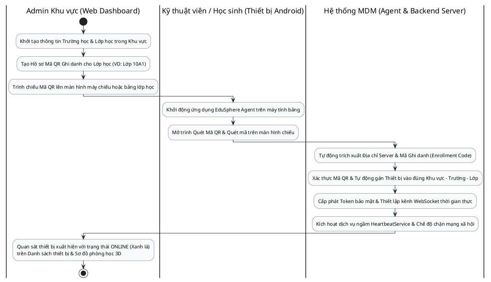

---

### 2.9.2. Quy trình giám sát trực quan và xử lý vi phạm tự động (Live Monitoring & Auto-Enforcement)

Trong quá trình học tập với thiết bị số, thách thức lớn nhất là học sinh dễ bị xao nhãng bởi các ứng dụng mạng xã hội và trò chơi điện tử, trong khi người quản lý không thể đi kiểm tra từng bàn. Hệ thống giải quyết triệt để vấn đề này thông qua quy trình **Phòng vệ chủ động kết hợp Giám sát trực quan**:
1. **Giám sát ngầm tự động (Zero-touch Monitoring)**: Trong suốt giờ học, bộ lọc `RuleDetector` trên `Android Agent` liên tục kiểm tra ứng dụng đang mở mỗi 1,5 giây mà không cần sự can thiệp thủ công từ máy chủ.
2. **Cưỡng chế khóa màn hình tức thời tại thiết bị**: Ngay khi học sinh mở ứng dụng nằm trong danh sách cấm (TikTok, Facebook, Instagram, YouTube, Zalo, Game...), Agent lập tức đóng ứng dụng, kích hoạt màn hình khóa Kiosk (`LockActivity`) và khóa cứng thiết bị.
3. **Phản hồi trực quan thời gian thực trên Web Dashboard**: Đồng thời với việc khóa máy, một gói sự kiện vi phạm được đẩy qua WebSocket về máy chủ. Trên màn hình `Web Dashboard` của Admin/Giáo viên, chuông cảnh báo vang lên và mô hình máy tính bảng trên **Bản đồ 3D** chuyển sang màu vàng/đỏ nhấp nháy, hoặc người quản lý có thể bấm **"Xem Màn hình Trực tiếp"** để kiểm tra tình trạng thực tế.
4. **Xử lý và khôi phục**: Sau khi nhắc nhở học sinh, Admin/Giáo viên nhấn nút **"Mở khóa thiết bị"** và **"Hoàn thành xử lý cảnh báo"** ngay trên giao diện Web để thiết bị trở lại trạng thái học tập bình thường.

#### Hình 2.33. Sơ đồ quy trình giám sát trực quan và xử lý kỷ luật

```plantuml
@startuml Hinh_2_33_QuyTrinh_GiamSat_XuLyViPham
skinparam linetype ortho
skinparam shadowing false
skinparam conditionStyle inside
skinparam activity {
    BackgroundColor #F8FAFC
    BorderColor #334155
    ArrowColor #1E293B
}

|Học sinh (Thiết bị Android)|
start
:Sử dụng máy tính bảng trong giờ học;
:Mở ứng dụng giải trí / mạng xã hội (TikTok, Facebook, YouTube, Game...);

|Android Agent (Phòng vệ Chủ động)|
:RuleDetector phát hiện Package Name thuộc danh sách bị cấm;
:Ép thoát về Màn hình Chính (HOME) & Khóa máy tức thời (LockActivity);
:Gửi sự kiện vi phạm (BLACKLIST_APP_DETECTED) qua WebSocket;

|MDM Backend Server|
:Ghi nhận sự kiện, khởi tạo Cảnh báo (Alert) theo Khu vực;
:Chuyển trạng thái thiết bị sang WARNING / CRITICAL;
:Phát sóng thông báo khẩn cấp (NEW_ALERT) tới Web Dashboard;

|Admin / Giáo viên (Web Dashboard)|
:Nhận thông báo cảnh báo & Định vị máy vi phạm nhấp nháy trên Bản đồ 3D;
:Kiểm tra chi tiết vi phạm hoặc bật Xem Màn hình Trực tiếp (Live View);
:Nhắc nhở học sinh & Phát lệnh "Mở khóa thiết bị" (UNLOCK_DEVICE) từ xa;

|Android Agent (Phòng vệ Chủ động)|
:Nhận lệnh UNLOCK_DEVICE -> Tắt màn hình khóa LockActivity;

|Admin / Giáo viên (Web Dashboard)|
:Đánh dấu Cảnh báo "Hoàn thành" (RESOLVED)\n-> Thiết bị trở về trạng thái ONLINE (Xanh lá) bình thường;
stop
@enduml
```

---

## 2.10. Thiết kế bảo mật

Để đảm bảo an toàn thông tin và tính toàn vẹn cho hệ thống điều khiển thiết bị tập trung, giải pháp áp dụng mô hình bảo mật đa lớp từ thiết bị đầu cuối đến máy chủ:

1. **Bảo mật xác thực API và Cách ly phạm vi Khu vực (Stateless JWT & Campus Scope RBAC)**:
   - Mọi yêu cầu REST API từ `Web Dashboard` đều phải đính kèm `Authorization: Bearer <access_token>`. Tại tầng máy chủ, `get_current_user` kiểm tra chữ ký số `HMAC-SHA256`, thời hạn hiệu lực của token và trạng thái kích hoạt (`is_active`) của tài khoản trong cơ sở dữ liệu.
   - Cơ chế **Campus Scope Isolation** (`resolve_scoped_campus_id` và `verify_campus_access`) ngăn chặn tuyệt đối việc leo thang đặc quyền ngang (Horizontal Privilege Escalation): một tài khoản `Admin` thuộc Khu vực A không thể đọc danh sách, xem màn hình hay gửi lệnh điều khiển tới bất kỳ thiết bị nào thuộc Khu vực B, kể cả khi biết trước `UUID` của thiết bị đó.
2. **Bảo mật Kênh truyền Thời gian thực (WebSocket Handshake Security)**:
   - Khác với các kết nối WebSocket mở tự do, cả hai đầu cuối `/api/ws/agent/{device_id}` và `/api/ws/dashboard` đều bắt buộc xác thực JWT ngay tại bước bắt tay (`Handshake`).
   - Đối với kênh Agent, máy chủ đối chiếu `sub` bên trong `Device Token` phải trùng khớp chính xác với tham số `{device_id}` trên đường dẫn URL (nếu sai lệch lập tức đóng kết nối với mã `4003 Forbidden`), ngăn chặn việc một thiết bị giả mạo định danh để chèn khung hình hoặc gửi thông số giả cho thiết bị khác.
3. **Bảo mật Cưỡng chế trên Thiết bị đầu cuối (Device-level Security)**:
   - Ứng dụng `Android Agent` vận hành dưới quyền **Device Owner** (`MDMAdminReceiver`), vô hiệu hóa nút *"Gỡ cài đặt"* (Uninstall) và chặn học sinh tự ý tắt quyền quản trị hoặc khôi phục cài đặt gốc.
   - Thông tin nhạy cảm trên thiết bị (`registration_token`, trạng thái khóa `isDeviceLocked`) được lưu trữ trong vùng nhớ riêng tư (`Context.MODE_PRIVATE`) của ứng dụng.
   - Màn hình khóa `LockActivity` sử dụng chế độ Kiosk (`startLockTask`) kết hợp cờ bảo vệ hệ thống để vô hiệu hóa toàn bộ phím điều hướng vật lý/ảo khi máy đang bị khóa vi phạm.

---

## 2.11. Triển khai hệ thống

Để đảm bảo khả năng vận hành ổn định, dễ dàng cài đặt và mở rộng quy mô cho nhiều cơ sở trường học, hệ thống được thiết kế theo kiến trúc đóng gói **Docker Containerization** kết hợp máy chủ điều hướng **Nginx Reverse Proxy**.

#### Hình 2.34. Sơ đồ kiến trúc triển khai đóng gói hệ thống

```plantuml
@startuml Hinh_2_34_KienTruc_TrienKhai
top to bottom direction
skinparam linetype ortho
skinparam nodesep 55
skinparam ranksep 60
skinparam componentStyle rectangle
skinparam shadowing false
skinparam node {
    BackgroundColor #F8FAFC
    BorderColor #334155
}
skinparam component {
    BackgroundColor #FFFFFF
    BorderColor #1E293B
}

node "Môi trường Người dùng & Lớp học (Client Environment)" {
    component "Trình duyệt Quản trị\n(Chrome / Edge - Web Dashboard)\n[Super Admin & Admin Khu vực]" as Browser
    component "Thiết bị Di động Học sinh\n(Android Tablet / Smartphone)\n[EduSphere Agent APK - Device Owner]" as Tablet
    Browser -[hidden]right- Tablet
}

node "Tầng Cổng Giao tiếp & Phân phối (Gateway & CDN Layer)" {
    component "Cloudflare / Static Web Hosting\n(Phân phối tài nguyên tĩnh React:\nHTML, CSS, JS, Three.js Assets)" as CDN
    component "Nginx Reverse Proxy\n(Port 80 / 443 - SSL/TLS Termination)\nĐịnh tuyến HTTPS REST & WSS WebSocket" as Nginx
    CDN -[hidden]right- Nginx
}

node "Máy chủ Ứng dụng & CSDL (Docker Compose Host / Cloud VPS)" {
    component "Docker Container: mdm-server\n(Python 3.12 + Uvicorn / FastAPI :8081)\nREST API + Pure WebSocket Hub + In-Memory Store" as FastAPI_Container
    database "Docker Container: postgres-db\n(PostgreSQL 16 :5432)\nPersistent Volume: pgdata" as PG_Container

    FastAPI_Container -down-> PG_Container : Docker Internal Network\n(SQLAlchemy AsyncPG :5432)
}

Browser -down-> CDN : Tải giao diện Web\n(HTTPS)
Browser -down-> Nginx : Gọi REST API & WebSocket\n(HTTPS / WSS)
Tablet -down-> Nginx : Ghi danh, Heartbeat, Live Stream\n(HTTP/HTTPS & WS/WSS)

Nginx -down-> FastAPI_Container : Proxy Pass\n(http://mdm-server:8081)
@enduml
```

1. **Triển khai Backend và Cơ sở dữ liệu bằng Docker Compose**:
   - **MDM Server (`mdm-server`)**: Được đóng gói thành Docker Image chạy trên nền Python 3.12 và ASGI Server `Uvicorn` (cổng `8081`). Nhờ tích hợp sẵn bộ nhớ đệm thời gian thực `In-Memory Realtime Store` bên trong tiến trình bất đồng bộ `AsyncIO`, hệ thống giảm thiểu sự phụ thuộc vào các dịch vụ trung gian bên ngoài, giúp việc khởi chạy và bảo trì cực kỳ gọn nhẹ.
   - **Cơ sở dữ liệu (`PostgreSQL 16`)**: Chạy trong Container độc lập, gắn kết với ổ đĩa bền vững (`Docker Volume`) để đảm bảo an toàn dữ liệu tổ chức, tài khoản, thiết bị, lịch sử lệnh và các bản chụp thông số (`device_metrics_snapshots`).
2. **Điều hướng và Bảo mật đường truyền bằng Nginx Reverse Proxy**:
   - Đứng trước máy chủ ứng dụng là **Nginx** tiếp nhận toàn bộ lưu lượng truy cập tại cổng `80/443`, thực hiện giải mã chứng chỉ bảo mật **SSL/TLS** (`HTTPS` và `WSS - WebSocket Secure`) và hỗ trợ nâng cấp kết nối (`Connection: Upgrade`, `Upgrade: websocket`) với thời gian duy trì kết nối dài (`proxy_read_timeout 3600s`) để giữ luồng kết nối liên tục cho hàng trăm thiết bị Android Agent.
3. **Triển khai Frontend và Ứng dụng Thiết bị**:
   - **Web Dashboard (`web-dashboard`)**: Mã nguồn React + TypeScript + Three.js được biên dịch tối ưu thông qua `vite build` thành gói tài nguyên tĩnh (`dist/`) và triển khai trên Nginx hoặc nền tảng CDN đám mây.
   - **Android Agent (`android-agent`)**: Được biên dịch thành tệp cài đặt `.apk`, cài đặt lên thiết bị của nhà trường và kích hoạt quyền **Device Owner** qua giao thức ADB một lần duy nhất trước khi đưa vào vận hành thông qua mã QR.

